# vLLM Serving Benchmark Lab

A reproducible single-GPU LLM serving experiment built around **vLLM**, **Qwen3-4B-Instruct**, and an OpenAI-compatible FastAPI gateway.

The project started as a concurrency benchmark and evolved into an overload-control study:

> How should an inference gateway decide whether to admit a request when requests have very different prompt and output costs?

The final V1 design compares three policies under the same heterogeneous traffic:

1. **Baseline** — admit everything.
2. **Static protected** — bound request count with fixed in-flight and waiting limits.
3. **Token-cost-aware** — estimate request cost from prompt tokens and output cap, then admit only while total estimated work remains below a cost budget.

The final result is intentionally nuanced: token-cost-aware admission provides a controllable latency-vs-rejection frontier and strongly protects tail latency under overload, but this first-order linear cost model does **not** dominate a well-tuned static concurrency limiter at matched rejection/throughput.

---

## Offline planned-cap prediction prototype (2026-10-20 UTC)

[Results and reproducible scores](results/transition-prototype-20261020/report.md) ·
[Method and commands](experiments/transition-prototype-v1.md)

Eight qualified captures pass fresh raw-data audits and **2,400** one-second
state/flow conservation checks. Prediction inputs use the premeasurement cap
plan, exclude future actual application timing, and purge labels unavailable at
the training cutoff. C remains untouched; this is an offline model, not MPC.

At five seconds, chronological pooled SLO-goodput rate MAE is **1.168 req/s** for
direct ridge, versus **1.366** for persistence and **1.396** for the flow rollout.
One/two-second rollouts improve on persistence, but their longer rollouts and
engine-gauge additions are not reliably better. The rollout is **not ready as a
validated MPC simulator**; full per-run, transfer and tail results are retained.

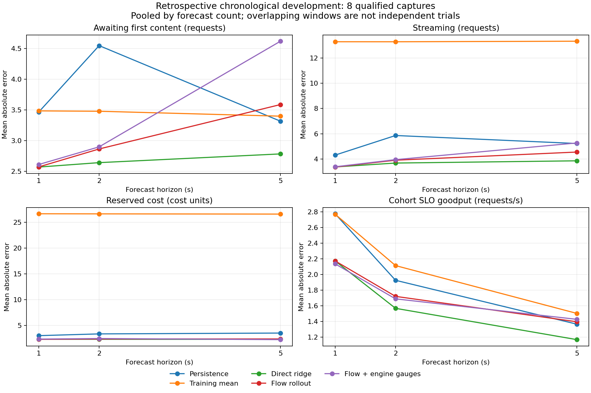

## Latest GPU results: same-host fixed-cap range (2026-10-20 UTC)

**[Full findings, original data and reproduction](results/cap-range-20261020/report.md)** ·
[中文分析](results/cap-range-20261020/analysis-zh.md) ·
[Recomputed audit/results](results/cap-range-20261020/summary.json) ·
[Original partial suite](results/cap-range-20261020/suite.json)

One RTX 4090 backend replayed the same 7,643 arrivals over 300 s at fixed reservation
caps 16/32/64/96 on runtime `31f1079`. Exact-revision native CPU acceptance passed
**504 cases**. Smoke and six full captures pass all six enabled gates; cap16-r2
fails load/external-diagnostic gates and cap64-r2 was not started. **The original
suite remains failed/incomplete**, with all 161 original files archived.

| Fixed cap | Qualified r1 goodput | Qualified r2 goodput |
|---|---:|---:|
| 16 | 4.130/s | Failed gates; retained for diagnosis |
| 32 | **5.080/s** | **4.590/s** |
| 64 | 2.267/s (one 502 failure counted) | Not started |
| 96 | 3.330/s | 2.667/s |

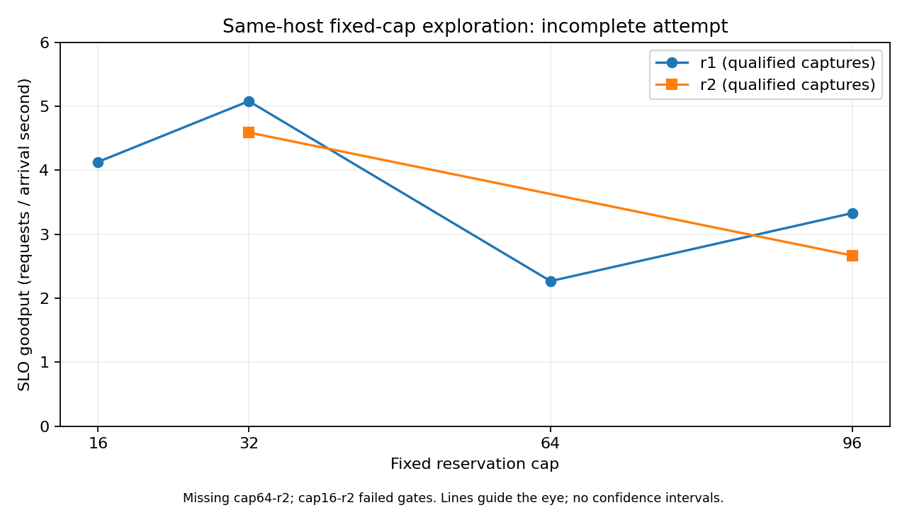

Cap 32's observed mean goodput exceeds cap 96 by 61.26%; it also has more SLO
successes in every matched 30 s arrival cohort in both repeats. These are
development observations, not a causal estimate, independent-bin significance
test, global optimum or MPC result. Cap 32 is a candidate fixed baseline and
**does not achieve P99 TTFT≤0.5 s**. The failed cap16-r2 has a 5.855 s gateway monitor
delay overlapping a vLLM metrics timeout, with no overlapping gateway GC span;
its 37 late launches occur during recovery. Root cause remains unproven.

The [frozen collection runbook](experiments/cap-range-v1.md) is historical for this
attempt. The new read-only reproducer preserves failure and re-audits all 8 reports;
it does not bypass the strict full-suite analyzer. C remains unused, and predictive
model/low-cap switching readiness is not established.

## Previous results: shared-client A/B system identification (2026-10-18 UTC)

**[Experiment index, complete raw data and reproduction](results/shared-client-20261018/report.md)** ·
[中文分析](results/shared-client-20261018/analysis-zh.md) ·
[Audit and runtime verification](results/shared-client-20261018/verification.json)

The original per-request excitation A stopped at 210 s when a budget application
missed the unchanged 50 ms deadline (52.884 ms). Its complete failed capture is
preserved. Reusing one opt-in gateway HTTP transport then qualified a fresh
smoke/A series and a fresh-host smoke/B series on runtime `d0ccb2c`.
Each rental host passed **476 native CPU/mock cases** at that exact runtime;
A/B reports independently reproduce, all recorded source hashes match, and
all **306 / 307** gateway snapshots match lifecycle reconstruction.

| Capture | Successful / rejected / failed | SLO successes | SLO goodput | Max arrival lag | Max budget application lag |
|---|---|---:|---:|---:|---:|
| [Shared A](results/shared-client-20261018/captures/shared-client-a-r1/report.json) | 1976 / 5667 / 0 | 572 | 1.907/s | 17.13 ms | 26.86 ms |
| [Shared B](results/shared-client-20261018/captures/shared-client-b-r1/report.json) | 2059 / 5584 / 0 | 736 | 2.453/s | 15.40 ms | 18.97 ms |

Both replay the same 7,643 arrivals over 300 s, with 30 s holds across caps
48/64/80/96. All six enabled measurement gates pass. A/B were collected on
**different rental hosts**; the totals do not establish a causal schedule
improvement or an optimal cap. The forecasting analysis archived in this section
used shared-client A/B only, keeping legacy captures separate; the newer
transition prototype above also includes qualified cap-range captures.

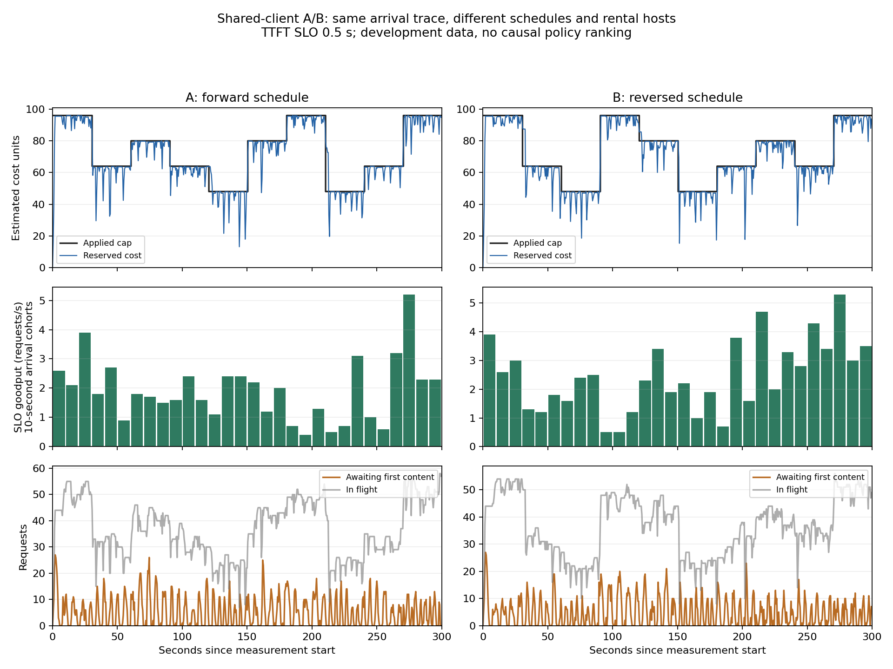

**Measurement is qualified; model and MPC readiness are not established.**
One- and two-second ridge forecasts beat persistence in development splits,
but five-second SLO-success/miss forecasts remain unstable. Phase/history
features, planned-control inputs, administrative-version removal, a fixed
nonlinear baseline and state×cap interactions were tested offline. These
comparisons do not establish a reliable five-second goodput control model.

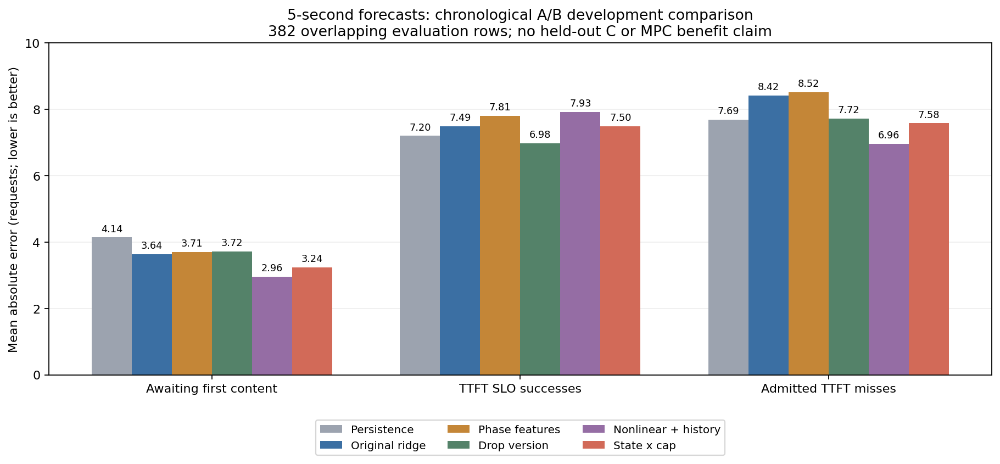

The [three byte-identical upload archives](results/shared-client-20261018/raw-bundle/)
contain **139 original files** (failed A, shared A and shared B), including CPU,
setup, launch, lifecycle and diagnostic evidence. Small capture folders are
browsing subsets; use the SHA256-checking extraction helper for full inputs.
The [reproduction entry point](results/shared-client-20261018/reproduce.py)
rebuilds qualified features, baseline forecasts and optional extended diagnostics.
**Held-out C was neither collected nor scored; no closed-loop MPC was run.**
The short-step transition prototype is now evaluated above. Causal engine-counter
rates remain future work; a final model and new C acceptance plan are not frozen.

---

## Runner launch-delay diagnostics

Opt-in `--runner-diagnostics` records the request runner's GC spans, event-loop
delays and CPU timing separately from the gateway and external sampler. It adds
a separate `runner_diagnostic_integrity` gate and offline alignment for all late
launches; it does not change GC policy, admission, budget or the 50 ms load gate.
See [the rental-host steps and capture protocol](experiments/runner-diagnostics.md).
This instrumentation is not a latency fix or an MPC performance result.

For the observed runner gen-2 GC stalls, an optional
[`--runner-gc-policy defer` mode](experiments/runner-gc-control.md) performs a
pre-measurement collection and bounded deferral during replay/drain, with an
explicit RSS allowance, watchdog, restoration and separate audit gate.
Automatic GC remains the default. The new capture below passes the load gate with
deferral; a matched causal improvement/observer-overhead claim is not established.

## Earlier results: qualified budget identification (2026-10-15)

**[Findings, raw data and reproduction](results/gc-identification-20261015/report.md).**
Three five-minute RTX 4090 runs at revision `33a0608` pass all six enabled gates:
data integrity, client load fidelity, control fidelity, gateway/external diagnostics,
runner diagnostics and bounded runner-GC evidence. The 50 ms limits are unchanged.
No MPC controller is evaluated.

| Strategy | Offered / success / rejected / failed | SLO successes | SLO goodput | Max scheduling lag |
|---|---|---:|---:|---:|
| [Fixed 96](results/gc-defer-fixed-96-r1/report.json) | 7643 / 2095 / 5548 / 0 | 466 | 1.553/s | 28.44 ms |
| [Fixed 64](results/gc-defer-fixed-64-r1/report.json) | 7643 / 1814 / 5829 / 0 | 638 | **2.127/s** | 19.70 ms |
| [96→64→96](results/gc-defer-step-96-64-96-r1/report.json) | 7643 / 1972 / 5671 / 0 | 433 | 1.443/s | 19.70 ms |

- Fixed 64 has 36.9% more observed SLO successes than fixed 96, with more rejection;
  one run per arm does not establish an optimal cap or a causal improvement rate.
- **Variation precedes switching:** during the first 100 seconds both the fixed-96
  and step runs use cap=96, but have 161 versus 95 SLO successes. Full-run totals
  alone cannot diagnose the effect of switching.
- The down-step applies when reserved cost is already 62.24, below 64, so this does
  not identify over-cap drain time. After the up-step, 27 admissions / 44,698 input
  tokens enter in two seconds; all complete but miss the 0.5 s TTFT deadline.
- Four original reports, including [smoke](results/gc-defer-smoke-96-r1/report.json),
  reproduce exactly in independent offline audits. All recorded source hashes match;
  `git_dirty=true` and the lack of backend launch/cache-flag evidence are retained.
  This is not full exact-revision native CPU acceptance or MPC benefit evidence.

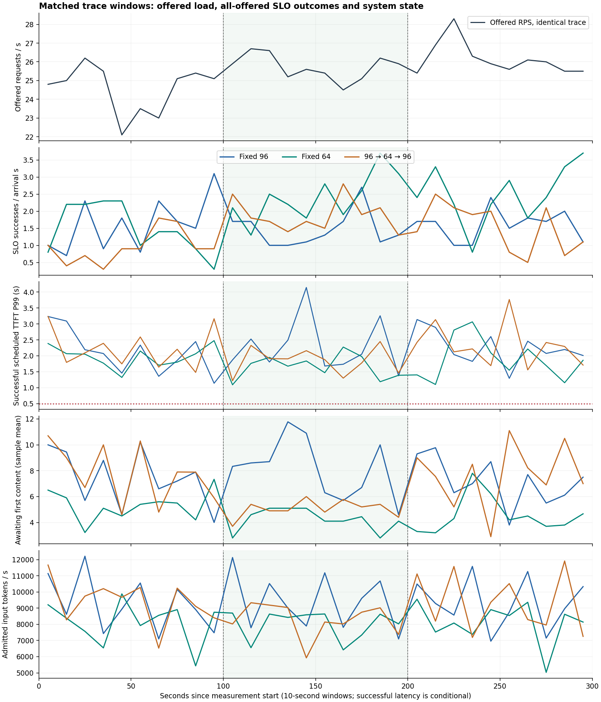

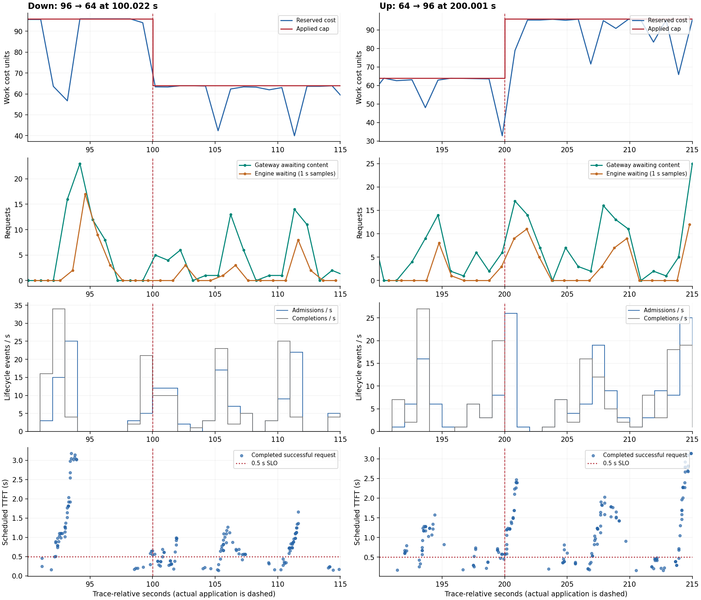

The [complete byte-identical uploaded archive](results/gc-identification-20261015/raw-bundle/)
contains **78 original files**. An extraction helper verifies archive/part/file hashes;
small run directories expose browsing subsets, not complete audit inputs.
[Computed facts](results/gc-identification-20261015/facts.json),
[audit verification](results/gc-identification-20261015/verification.json), and
[the Chinese report](results/gc-identification-20261015/gc-defer-ident-analysis-20261015.html)
are included. [Offline causal features and forecast baselines](experiments/forecast-baselines.md)
now score development-only persistence/mean/ridge forecasts on these captures
(development results are published above; model readiness not established). Historical next step:
[excitation v1](experiments/excitation-v1.md), a predeclared multi-level
(48–96) counterbalanced pair plus one held-out window and schedule, with
forecast limits frozen on 2026-10-17 before collection. The original collection
revision passed 467 native CPU tests; model/MPC readiness is not established.

The first excitation-v1 A attempt stopped on a 52.884 ms budget application
(50 ms limit). The opt-in [shared-client qualification](experiments/shared-client-qualification-v1.md)
removes per-request HTTP transport construction and declares a fresh smoke/A
series with the same limits. Original excitation-v1 and its failed capture are
preserved; the held-out window remains unused.

---

## Previous capture: RTX 4090 diagnostics (2026-10-12)

**[Read the diagnostic findings and reproduction steps](results/diagnostics-20261012/report.md).**
This round adds measured GC/CPU and engine observations to the earlier trace
investigation. Admission budget remains **96**; no MPC controller is evaluated.
The GPU has been returned; the complete capture and native validation evidence
are preserved in the repository.

| Capture | Offered / successful / rejected / failed | Data integrity | Load fidelity | Diagnostic integrity | Max client scheduling lag | SLO goodput |
|---|---|---|---|---|---:|---:|
| [Diagnostic smoke, 30 s](results/trace-diag-smoke-96-r1/report.json) | 787 / 233 / 554 / 0 | PASS | PASS | PASS | 5.30 ms | 3.533/s |
| [Diagnostic experiment r1, 300 s](results/trace-diag-experiment-96-r1/report.json) | 7,643 / 2,063 / 5,580 / 0 | PASS | **FAIL** | PASS | 146.53 ms | 1.363/s |

The long run has **409 SLO successes**, client TTFT P99 **2.814 s**, and nine
launches beyond the predeclared **50 ms** maximum scheduling-lag gate. It remains
useful for diagnosis, but is not a load-fidelity-passing policy comparison.

- Four long generation-2 GC spans on the gateway event-loop thread last
  **384–485 ms**, overlapping **66.2%** of the summed four monitor-overdue
  intervals. This identifies an important component of these pauses, not their
  sole cause or the expected improvement from disabling GC.
- **93.72%** of the slowest 21 successful requests' summed TTFT is post-dispatch.
  None of those intervals directly overlaps the long GC spans; sampled engine
  backlog and admission/refill waves also matter. This is not exclusive GPU
  timing or proof of GPU saturation.
- Native Linux CPU validation: **135 passed**. External-only fake-backend
  success/rejection/failure cases: **all passed**. Five saved capture reports
  and the uploaded dynamics summary were independently reproduced exactly.

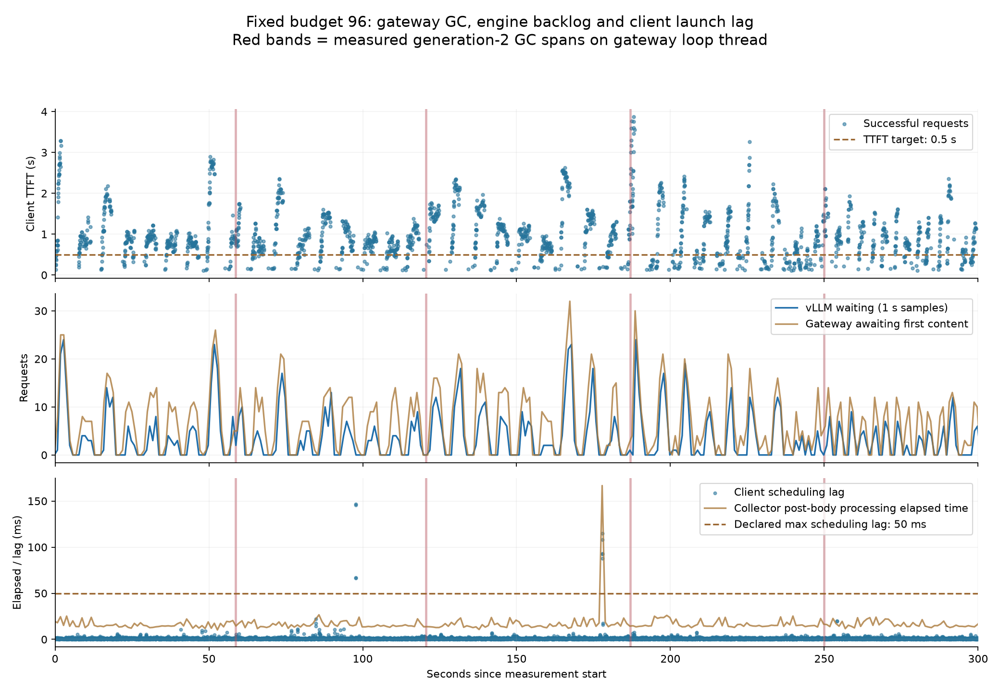

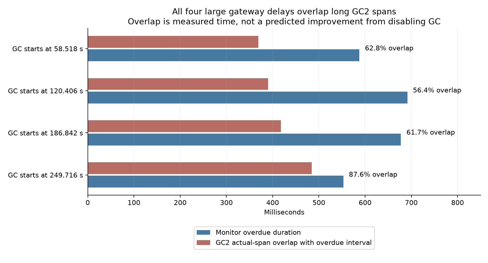

Evidence and handoff:
[complete raw archive, 21.1 MB / 81 files](results/diagnostics-20261012/raw-bundle/),
[computed facts and all raw hashes](results/diagnostics-20261012/facts.json),
[native validation](results/diagnostics-20261012/native-validation/),
[verified launch flags](results/diagnostics-20261012/setup/launch.json), and
[downloadable self-contained Chinese HTML report](results/diagnostics-20261012/vllm-diagnostics-report-20261012.html).
The small diagnostic run directories expose reports/manifests for browsing;
extract the archive to access their full raw captures and reproduce analysis.
Recorded code is `f1f7cef`; driver **580.178.04**, Torch **2.13.0+cu130**,
Qwen3-4B-Instruct-2507, context 8,192, prefix caching disabled with launch evidence.

**Historical handoff at publication:** complete the
[native Linux CPU acceptance](experiments/runtime-telemetry.md#cpu-validation-and-handoff)
for the opt-in external sampler process mode and identification tooling at the
exact revision. A manual-only CI workflow and the same rental-host entry point
are provided; execution is deferred until a suitable host is available, not
claimed by adding the configuration.
Then follow the [staged identification protocol](experiments/trace-identification.md):
one qualified fixed-budget baseline, one lower candidate, then predeclared
down/up steps on the **same trace**, rather than an initial GPU matrix.
`--budget-schedule` adds trace-relative control with a saved/audited plan;
optional `--e2e-slo` makes goodput joint TTFT/E2E with all offered requests
retained. Model fitting and shadow/closed-loop MPC are not implemented.
An optional, separately approved [thread/process comparison](experiments/trace-replay.md#sampler-isolation-ab-after-native-validation)
can investigate observer overhead without relaxing the 50 ms client gate.
Process isolation is not yet evidence of lower latency, negligible diagnostic
overhead or MPC benefit.

---

## Previous capture: RTX 4090 trace-analysis handoff (2026-10-11)

**Historical handoff for the earlier capture.** Its task was to verify the
uploaded smoke/r1/r2 records, align lifecycle events with gateway pauses and client
lateness, and test whether the two repeats reproduce the same pattern. This is
pre-MPC diagnosis; a predictive controller has not been implemented or evaluated.
The RTX 3090 V1 study below is historical and uses a different workload.

### Uploaded data and experiment boundary

Raw-data commit: [`1cafbda`](https://github.com/dlinlabs/vllm-serving-lab/commit/1cafbda60a9d140e1f023c7e42a58bf00a2d10bc).
Recorded experiment code: `a3cdf68bcce2d2d933a575538da5889b538c5366`.

| Run | Raw directory | Arrival window | Offered / successful / rejected / failed | Integrity | Load fidelity | Maximum client scheduling lag |
|---|---|---:|---|---|---|---:|
| Smoke | [trace-smoke-96](results/trace-smoke-96/) | 30 s | 787 / 248 / 539 / 0 | PASS | PASS | 8.41 ms |
| r1 | [trace-experiment-96-r1](results/trace-experiment-96-r1/) | 300 s | 7,643 / 2,239 / 5,404 / 0 | PASS | **FAILED** | 208.07 ms |
| r2 | [trace-experiment-96-r2](results/trace-experiment-96-r2/) | 300 s | 7,643 / 2,220 / 5,423 / 0 | PASS | **FAILED** | 175.38 ms |

All three directories contain ten nonempty collected artifacts:
`manifest.json`, `trace.json`, `client.json`, `warmup.json`, `gateway.jsonl`,
`budget_changes.json`, `state_observations.json`, `telemetry_status.json`,
`report.json`, and `timeseries.png`. This confirms the uploaded replay bundle,
**not all machine logs**: `gateway-process.log` and vLLM launch logs are absent
from this upload. Do not infer launch flags or engine warnings from their absence.

Common setup: **RTX 4090 / driver 580.159.04 / 24,564 MiB**, Python 3.12.3,
vLLM 0.30.0, PyTorch **2.13.0+cu130**, Qwen/Qwen3-4B-Instruct-2507,
context limit 8,192. Fixed budget **96**, output cap **128**, natural EOS,
TTFT SLO **0.5 s**, predeclared maximum client scheduling lag **50 ms**.
Cache policy `disabled` is self-reported; launch logs are needed to verify it.
Three successful warmup requests per run are excluded from measurement performance
but included in gateway cumulative counters.

The repeats use an identical trace SHA-256:
`62f3f182bcb889c846b5a46a05a53766ef20c5f79008e9050a4fe33707bc4e2e`.
Their source window begins **2024-05-12 00:01:00 UTC** and lasts 300 s;
7,652 source rows minus nine too-short contexts gives 7,643 retained rows.
No thinning or context-overflow exclusions. The
[versioned presets](experiments/trace-presets.json),
[replay protocol](experiments/trace-replay.md), and
[source download record](results/trace-source/download.json) describe provenance.
Azure arrivals and input lengths are replayed with synthetic prompts. Historical
output lengths are audit-only. All successful measurement requests in these runs
actually generated 128 tokens, so variable decode demand is not covered yet.

### How to align and review the records

1. **Re-audit completeness first.** Check trace/file hashes, run IDs, telemetry
   persistence, request-ID uniqueness, terminal outcomes, and final drain. Preserve
   the separate integrity and load-fidelity verdicts; do not drop late requests or
   relax the 50 ms limit after observing results.
2. **Join by `client_request_id`**, matching gateway `request_id`. Measurement
   rows are in `client.json`; warmups are separate. Runner and gateway share the
   same host monotonic clock. Normalize each run by its own manifest
   `measurement_start`; do not compare absolute monotonic timestamps across runs.
3. **Decompose the same successful requests:** client `started_at` → gateway
   `received` → `accepted` → `backend_sent` → gateway `first_content` → client
   `first_content_at`. Each sum must reconcile to client TTFT. Do not subtract
   independent P99 values. `received` means handler entry, not socket arrival;
   `backend_sent` is logged before awaiting upstream HTTP send, not GPU execution.
4. **Locate pauses and client lateness separately.** Use `event_loop_lag` callback
   due/resume times, nearby adjacent lifecycle gaps, planned→started client lag,
   and metrics-poll RTT/gaps. Callback lateness and missing lifecycle activity are
   symptoms; neither directly measures a CPU, GC, or GPU pause. Check timing
   overlap explicitly rather than assuming the processes stalled together.
5. **Compare cadence and tail attribution.** Examine both wall-time spacing and
   admitted-request increments between pauses, original vs handler arrival peaks,
   input mix, and reserved cost. Treat gateway awaiting/streaming/cost as state
   proxies, not engine queue length or measured GPU work. Keep any diagnosis
   descriptive until a discriminating experiment identifies a cause.
6. **Report limits and next measurements.** Both long runs failed load fidelity,
   there are only two repeats, output demand is fixed, and budget never changes.
   These records cannot establish MPC benefit, optimal update frequency, or the
   causal response to changing budget.

### Existing analysis available for independent review

[PR #11](https://github.com/dlinlabs/vllm-serving-lab/pull/11) contains an
offline analyzer, raw-file hashes, same-cohort tail attribution, pause alignment,
and next-experiment proposals. These are review inputs, not confirmed root causes.
Read the raw records first if performing an independent diagnosis.

- [Pinned diagnosis report](https://github.com/dlinlabs/vllm-serving-lab/blob/4ea4ef8610d4ad12b814435fafdd9329164a68fb/results/trace-budget96-analysis/report.md)
- [Pinned audit summary](https://github.com/dlinlabs/vllm-serving-lab/blob/4ea4ef8610d4ad12b814435fafdd9329164a68fb/results/trace-budget96-analysis/summary.json)
- [Pinned analyzer](https://github.com/dlinlabs/vllm-serving-lab/blob/4ea4ef8610d4ad12b814435fafdd9329164a68fb/analyze_trace_dynamics.py)

Reproduce that analysis in a separate checkout (CPU only; dependencies: NumPy,
Matplotlib, and HTTPX). The analyzer runs the existing auditor in a temporary
directory and writes new outputs separately, preserving raw reports and figures:

```bash
git fetch origin main
git worktree add --detach ../trace-review 4ea4ef8610d4ad12b814435fafdd9329164a68fb
cd ../trace-review
python analyze_trace_dynamics.py \
  results/trace-smoke-96 \
  results/trace-experiment-96-r1 \
  results/trace-experiment-96-r2 \
  --output-dir results/trace-independent-analysis
```

The analysis files are included in this repository through PR #11. The pinned
links above preserve the initial diagnosis for reproducibility. The review output
should distinguish
**verified observation → plausible mechanism → evidence needed to discriminate**,
with reproducible calculations and links to the relevant raw requests/events.

The [periodic-pauses investigation protocol](experiments/periodic-peaks-investigation.md)
now has two implementation groups in PR #12: offline accounting for every offered
request, and default-off gateway/GC/CPU diagnostics with external engine/resource
sampling and separate diagnostic audits. Existing schema-1 logs remain usable;
new investigation outputs do not overwrite raw bundles. See
[trace replay](experiments/trace-replay.md) for the flags and artifacts, and
[runtime telemetry](experiments/runtime-telemetry.md) for measurement boundaries.
The implementation changes no admission policy and introduces no MPC controller.
At the time of this earlier handoff, full-suite validation and new GPU diagnostics
were pending. The 2026-10-12 section above records their completion; negligible
overhead, historical causal attribution, and policy benefit remain unestablished.

---

## 1. Final Architecture

```text
Open-loop benchmark client
        |
        | streaming /v1/chat/completions
        v
+----------------------------------------------+
| FastAPI Admission Gateway :8080              |
|                                              |
|  ADMISSION_MODE=baseline                     |
|      -> pass through                         |
|                                              |
|  ADMISSION_MODE=protected                    |
|      -> MAX_IN_FLIGHT                        |
|      -> MAX_WAITING                          |
|      -> reject excess work with HTTP 503     |
|                                              |
|  ADMISSION_MODE=cost_aware                   |
|      -> apply Qwen chat template/tokenizer   |
|      -> estimate prompt tokens               |
|      -> estimate request cost                |
|      -> track current admitted cost          |
|      -> reject if budget would be exceeded   |
+----------------------------------------------+
        |
        | streaming proxy
        v
vLLM OpenAI-Compatible Server :8000
        |
        v
vLLM scheduler / continuous batching / KV cache
        |
        v
Qwen/Qwen3-4B-Instruct-2507
        |
        v
NVIDIA RTX 3090 24 GB
```

The gateway preserves streaming semantics. This is important because buffering the complete response in the proxy would invalidate client-observed **TTFT (time to first token)**.

---

## 2. Final V1 Environment

The final cost-aware validation and A/B/C comparison used:

- GPU: NVIDIA RTX 3090 24 GB
- Model: `Qwen/Qwen3-4B-Instruct-2507`
- vLLM: `0.30.0`
- PyTorch: `2.13.0+cu130`
- CUDA: `13.0`
- Python: `3.12.3`
- Max model length: `8192`
- Streaming: enabled
- Cloud environment: RunPod

Earlier phases were run while the project was evolving and used earlier vLLM/PyTorch builds. Final policy comparisons were rerun under one common environment so the A/B/C result is internally comparable.

Start vLLM:

```bash
vllm serve Qwen/Qwen3-4B-Instruct-2507 \
  --host 0.0.0.0 \
  --port 8000 \
  --max-model-len 8192
```

---

## 3. Experiment Roadmap

| Phase | Question | Main independent variable | Why it was needed | Main conclusion |
|---|---|---|---|---|
| 1. Concurrency | Does more concurrency improve throughput? | Max concurrency | Establish batching/latency tradeoff | Throughput rises strongly, but TTFT/TPOT also rise |
| 2. Sustained load | Where does steady-state overload begin? | Arrival RPS | Fixed request counts do not expose queue growth | Tail latency collapses before outright failure |
| 3. Static admission | Can bounded request count protect latency? | In-flight / waiting limits | Prevent unbounded backlog | 64/8 gave the best tested static tradeoff |
| 4. Heterogeneous traffic | Does one request equal one unit of work? | Request shape | Real traffic has different prompt/output sizes | Fixed request-count thresholds are workload-dependent |
| 5. Token calibration | How do input/output tokens affect service time? | Input tokens / output tokens | Separate request shape from queueing | Input and output length contribute differently |
| 6. Shape saturation | How much capacity does each shape consume? | Shape + RPS | Convert shape into system-level cost | Approximate capacity ratio ~1:2:3 |
| 7. V1 cost-aware admission | Can the gateway admit by estimated work instead of count? | Cost budget | Replace “one request = one slot” | Works as a controllable overload policy |
| 8. Final A/B/C | Does V1 beat baseline/static protection? | Admission policy | Validate the actual project hypothesis | Beats unprotected baseline under overload, but not static at matched rejection |

---

# 4. Phase 1 — Fixed-Concurrency Benchmark

## Reason

The first question was basic capacity characterization: how much throughput does vLLM gain from continuous batching as more requests are allowed to run concurrently?

## Controlled workload

- 100 requests per run
- 256 input tokens/request
- 128 output tokens/request
- Temperature 0
- EOS ignored
- Max concurrency: `1, 4, 8, 16, 32, 64`

## Results

| Concurrency | Output tok/s | Mean TTFT | P99 TTFT | Mean TPOT |
|---:|---:|---:|---:|---:|
| 1 | 81.96 | 61.24 ms | 72.37 ms | 11.81 ms |
| 4 | 320.89 | 56.25 ms | 269.52 ms | 12.11 ms |
| 8 | 591.95 | 72.90 ms | 286.27 ms | 12.55 ms |
| 16 | 984.53 | 123.45 ms | 356.27 ms | 13.92 ms |
| 32 | 1632.44 | 202.30 ms | 350.69 ms | 14.68 ms |
| 64 | 2665.72 | 345.10 ms | 454.55 ms | 16.71 ms |

## Conclusion

Concurrency from 1 to 64 increased output throughput by about **32.5x**, but scaling became increasingly sublinear and per-request latency rose.

GPU utilization reached 100% before throughput stopped increasing, so:

> **GPU utilization alone is not proof of inference-server saturation.**

This phase measured batching behavior, not steady-state overload.

---

# 5. Phase 2 — Open-Loop Sustained Load

## Reason

A fixed number of requests cannot reveal what happens when new work keeps arriving faster than the server can finish it.

The benchmark was changed to **open-loop arrival scheduling**:

```text
arrival interval = 1 / target RPS
```

Request completion does not slow future arrivals, allowing queue growth and overload to emerge naturally.

## Metrics

`sustained_load.py` records:

- success / rejection / failure counts
- scheduling lag
- P50 / P95 / P99 TTFT
- P50 / P99 end-to-end latency
- realized prompt/output tokens

## Representative fixed-workload result

| RPS | P99 TTFT | P99 E2E |
|---:|---:|---:|
| 10 | 0.236 s | 2.004 s |
| 12 | 0.283 s | 2.158 s |
| 15 | 1.077 s | 3.262 s |
| 20 | 1.549 s | 4.383 s |
| 30 | 13.449 s | 18.772 s |

## Conclusion

Tail latency degraded sharply before request failures became common. At 30 RPS the server still accepted almost everything, but queueing made the service effectively unusable.

This motivated explicit admission control.

---

# 6. Phase 3 — Static Request-Count Admission

## Architecture difference

Protected mode adds two fixed limits:

```text
MAX_IN_FLIGHT
MAX_WAITING
```

If the gateway cannot admit more work, it returns HTTP `503` rather than allowing backlog to grow without bound.

Tested configurations:

```text
32 in-flight / 8 waiting
48 in-flight / 8 waiting
64 in-flight / 8 waiting
```

## Result

`64/8` was the best tested static configuration.

Historical severe-overload comparison at 30 RPS:

| Metric | Baseline | Static 64/8 |
|---|---:|---:|
| Reject rate | 0% | 36.9% |
| P99 TTFT | 13.449 s | 3.037 s |
| P99 E2E | 18.772 s | 5.195 s |

## Conclusion

Admission control does not make the GPU faster. It prevents unlimited queue growth by deliberately trading some availability for bounded latency.

However, this policy still assumes:

> **one request = one unit of capacity**

That assumption became the next problem.

---

# 7. Phase 4 — Heterogeneous Traffic

## Reason

Production inference requests do not have identical prompt/output lengths.

The deterministic benchmark cycles through:

```text
short_interactive -> medium -> long_context -> long_output -> repeat
```

Current workload definitions:

| Workload | Prompt characteristic | max_tokens |
|---|---|---:|
| short_interactive | short prompt | 64 |
| medium | repeated medium prompt | 128 |
| long_context | long repeated prompt | 128 |
| long_output | short prompt | 512 |

This isolates two important forms of work:

- **prefill pressure** from long prompts
- **decode pressure** from long generated outputs

## Key result

A fixed `64/8` policy behaved well at one mixed-load operating point and less well at another.

Historical mixed-workload examples:

| Policy / Load | Reject | P99 TTFT | P99 E2E |
|---|---:|---:|---:|
| Static 4/2 @ 25 RPS | 86.8% | 1.642 s | 3.001 s |
| Static 64/8 @ 25 RPS | 0% | 0.412 s | 3.305 s |
| Static 64/8 @ 30 RPS | 11.0% | 1.976 s | 4.284 s |

## Conclusion

A low request-count cap can reject too much and reduce batching efficiency. A larger cap can work well under one mix/load and poorly under another.

> **Static request-count admission is workload- and load-dependent.**

Detailed Phase 4 notes:

[experiments/heterogeneous-workload-2026-09-23.md](experiments/heterogeneous-workload-2026-09-23.md)

---

# 8. Phase 5 — Token-Cost Calibration

## Reason

The gateway needed a better representation of “how expensive is this request?”

Low-load calibration separated request shape from queueing:

```text
Load = f(arrival rate, input tokens, output tokens)
```

### Input sweep

Output stayed near 128 tokens while realized input grew from 32 to 1,418 tokens.

P50 TTFT increased approximately:

```text
68.8 ms -> 76.1 ms
```

### Output sweep

Input stayed near 98 tokens while output was forced to:

```text
32, 128, 256, 512, 1024
```

P50 E2E increased approximately:

```text
0.418 s -> 13.972 s
```

## Conclusion

Input and output token counts both matter, but low-load latency slopes are **not** sufficient admission weights because vLLM batching changes system behavior under load.

Detailed calibration:

[experiments/token-cost-calibration-2026-10-04.md](experiments/token-cost-calibration-2026-10-04.md)

---

# 9. Phase 6 — Workload-Shape Saturation

## Reason

Instead of deriving request cost from isolated latency alone, the next experiment measured how much sustainable arrival capacity each request shape consumed.

Three fixed shapes were driven toward saturation:

| Shape | Realized input | Realized output |
|---|---:|---:|
| Baseline | 98 | 128 |
| Prefill-heavy | 1,418 | 128 |
| Decode-heavy | 98 | 512 |

Each point was repeated three times and medians were used.

## Saturation results

### Baseline

| RPS | P99 TTFT | P99 E2E |
|---:|---:|---:|
| 10 | 0.126 s | 1.847 s |
| 15 | 0.217 s | 2.081 s |
| 20 | 0.740 s | 2.832 s |
| 25 | 1.747 s | 5.477 s |
| 30 | 2.855 s | 6.907 s |
| 35 | 4.612 s | 11.745 s |

Healthy region: roughly **20 RPS**.

### Prefill-heavy

| RPS | P99 TTFT | P99 E2E |
|---:|---:|---:|
| 5 | 0.150 s | 2.164 s |
| 8 | 0.154 s | 2.598 s |
| 10 | 0.197 s | 5.048 s |
| 12 | 0.903 s | 19.821 s |
| 15 | 18.093 s | 34.847 s |
| 20 | 30.029 s | 42.659 s |

Healthy region: roughly **10 RPS**.

### Decode-heavy

| RPS | P99 TTFT | P99 E2E |
|---:|---:|---:|
| 5 | 0.115 s | 9.247 s |
| 8 | 0.440 s | 18.046 s |
| 10 | 0.426 s | 26.759 s |
| 12 | 11.608 s | 34.137 s |
| 15 | 23.189 s | 44.665 s |
| 20 | 39.353 s | 58.229 s |

Practical healthy region: roughly **5–8 RPS**.

## Capacity-derived cost intuition

Using baseline capacity as normalized cost 1:

```text
baseline       ~20 RPS -> ~1x
prefill-heavy  ~10 RPS -> ~2x
decode-heavy   ~5-8 RPS -> ~2.5-4x
```

A convenient V1 approximation is:

```text
baseline : prefill-heavy : decode-heavy ~= 1 : 2 : 3
```

This is an empirical serving-capacity approximation, not a universal physical law.

---

# 10. Phase 7 — V1 Token-Cost-Aware Admission

## Cost model

The gateway uses:

```text
C(I, O) = c + alpha * I + beta * O
```

where:

- `I` = estimated prompt tokens before admission
- `O` = requested `max_tokens`
- actual output tokens are unavailable before the request runs, so V1 uses the output cap conservatively

The three calibration anchors are:

```text
C(98, 128)   ~= 1
C(1418, 128) ~= 2
C(98, 512)   ~= 3
```

Solving gives:

```text
COST_INTERCEPT  = 0.259
INPUT_TOKEN_COST = 0.000758
OUTPUT_TOKEN_COST = 0.0052083333
```

Therefore:

```text
request_cost =
    0.259
    + 0.000758 * estimated_input_tokens
    + 0.0052083333 * max_tokens
```

Admission condition:

```text
current_admitted_cost + request_cost <= MAX_ADMITTED_COST
```

If false, the gateway rejects the request with HTTP `503`.

## Runtime validation

The online tokenizer/cost path was validated against the same three shapes:

| Shape | Estimated input | max_tokens | Estimated cost |
|---|---:|---:|---:|
| Baseline | 98 | 128 | 1.000 |
| Prefill-heavy | 1,418 | 128 | 2.001 |
| Decode-heavy | 98 | 512 | 3.000 |

During this validation, a tokenizer integration bug was found: `BatchEncoding` length was being interpreted as token count. The gateway was fixed to explicitly read `input_ids`.

That failure was useful because it validated the end-to-end feature definition rather than assuming the offline and online token counts matched.

---

# 11. V1 Budget Tuning

## Reason

The cost model estimates **relative request weight**. `MAX_ADMITTED_COST` controls **how much total estimated work may be active at once**.

For example, with a budget of 80:

```text
80 baseline-cost requests      ~= budget 80
40 prefill-heavy requests      ~= budget 80
~26 decode-heavy requests      ~= budget 80
```

Real traffic is mixed, so the gateway tracks the sum of request costs rather than a request count.

## Controlled tuning experiment

Held constant:

- heterogeneous deterministic workload
- 25 RPS
- 30 seconds/run
- 3 repeats
- median reported

Changed only:

```text
MAX_ADMITTED_COST = 48, 64, 80
```

## Results

| Cost budget | Reject rate | P99 TTFT | P99 E2E |
|---:|---:|---:|---:|
| 48 | 25.60% | 1.320 s | 3.224 s |
| 64 | 17.73% | 1.564 s | 3.643 s |
| 80 | 10.53% | 1.747 s | 3.970 s |

## Conclusion

Increasing the budget moves along a clear latency-vs-rejection frontier:

- lower budget -> reject more, protect tail latency more aggressively
- higher budget -> accept more, allow more queueing/tail latency

Budget 80 was selected for the full A/B/C comparison because it accepted substantially more traffic than 48/64 without yet showing a severe latency cliff.

---

# 12. Phase 8 — Final A/B/C Comparison

## Experimental design

Three policies were compared:

### A. Baseline

```text
ADMISSION_MODE=baseline
```

No gateway-side overload protection.

### B. Static protected

```text
ADMISSION_MODE=protected
MAX_IN_FLIGHT=64
MAX_WAITING=8
```

Every request consumes one logical concurrency slot regardless of request shape.

### C. Cost-aware V1

```text
ADMISSION_MODE=cost_aware
MAX_ADMITTED_COST=80
```

Requests consume different amounts of the common cost budget.

## Controlled variables

All policies used:

- same RTX 3090
- same model
- same vLLM server configuration
- same deterministic heterogeneous workload
- same RPS points: `20, 25, 30`
- 30 seconds/run
- 3 repeats per point
- median across repeats
- streaming enabled
- temperature 0

The only intended difference was the admission policy.

## Final results

| RPS | Policy | Reject | P99 TTFT | P99 E2E |
|---:|---|---:|---:|---:|
| 20 | Baseline | 0.00% | 1.182 s | 3.533 s |
| 20 | Static 64/8 | 0.00% | 1.292 s | 3.785 s |
| 20 | Cost-aware 80 | 0.50% | **1.127 s** | **3.290 s** |
| 25 | Baseline | 0.00% | 2.390 s | 8.590 s |
| 25 | Static 64/8 | 1.87% | 1.859 s | 4.287 s |
| 25 | Cost-aware 80 | 11.07% | **1.795 s** | **4.151 s** |
| 30 | Baseline | 0.00% | 3.911 s | 9.208 s |
| 30 | Static 64/8 | 13.89% | 2.521 s | 4.815 s |
| 30 | Cost-aware 80 | 23.56% | **1.827 s** | **4.089 s** |

## Strongest overload result

At 30 RPS, cost-aware 80 versus unprotected baseline:

```text
P99 TTFT: 3.911 -> 1.827 s   (~53% lower)
P99 E2E:  9.208 -> 4.089 s   (~56% lower)
```

However, this improvement came with a 23.56% rejection rate.

Against static 64/8 at the same 30 RPS:

```text
P99 TTFT: 2.521 -> 1.827 s   (~27.5% lower)
P99 E2E:  4.815 -> 4.089 s   (~15.1% lower)
Reject:    13.89% -> 23.56%
```

This showed better tail latency, but not a fair dominance result because cost-aware 80 rejected substantially more traffic.

---

# 13. Matched-Rejection Follow-Up

## Reason

A lower P99 is not meaningful evidence of a better controller if it is achieved only by rejecting much more work.

The final follow-up increased the cost budget at 30 RPS to move cost-aware admission toward the static policy's rejection/throughput region.

## Results

| Policy | Reject | Approx. accepted req/s | P99 TTFT | P99 E2E |
|---|---:|---:|---:|---:|
| Static 64/8 | 13.89% | 25.83 | **2.521 s** | **4.815 s** |
| Cost-aware 80 | 23.56% | 22.93 | 1.827 s | 4.089 s |
| Cost-aware 96 | 18.33% | 24.50 | 2.190 s | 4.818 s |
| Cost-aware 112 | 15.67% | 25.30 | 2.724 s | 5.455 s |

Cost-aware 112 came close to static 64/8 in rejection rate and accepted throughput:

```text
Static reject:    13.89%
Cost-aware 112:   15.67%

Static accepted:  ~25.83 req/s
Cost-aware 112:   ~25.30 req/s
```

At that comparable operating point, static admission was better:

```text
P99 TTFT:
static 64/8     2.521 s
cost-aware 112  2.724 s

P99 E2E:
static 64/8     4.815 s
cost-aware 112  5.455 s
```

## Final interpretation

The V1 cost-aware controller is **not** a universal improvement over a tuned static limiter.

What the experiment does show:

1. Heterogeneous requests consume measurably different serving capacity.
2. A scalar token-cost model can convert those differences into an online admission signal.
3. The cost budget provides a clean way to move along the rejection-vs-tail-latency frontier.
4. Under severe overload, cost-aware admission can strongly reduce tail latency relative to unprotected serving.
5. At comparable rejection/throughput, this first-order linear V1 did not beat static 64/8.

That last result matters. It suggests that the remaining error is not simply “choose another budget”; the model itself omits important serving dynamics.

---

# 14. Why V1 Does Not Fully Model vLLM Cost

V1 compresses every request into one scalar:

```text
cost = intercept + alpha * input_tokens + beta * max_tokens
```

Real vLLM serving cost is more complex and nonlinear. It also depends on:

- continuous-batching composition
- number of active decode sequences
- realized output length, not only `max_tokens`
- KV-cache occupancy
- prompt/decode overlap
- scheduler state
- workload mix
- current queue/load
- GPU/model/runtime configuration

Therefore the V1 controller is **workload-aware**, but it is not **feedback-adaptive**.

A logical future progression is:

```text
V1: fixed token-cost model + fixed budget        <- completed
V2: fixed cost model + feedback-adaptive budget
V3: richer state model / predictive control
```

Possible V2/V3 signals include observed TTFT, admitted-cost pressure, queue depth, KV-cache state, active sequence count, and workload mix.

The completed V1 study is now being extended toward predictive admission control on the same single-GPU setup. The current work focuses on gateway diagnosis, system identification, and a future MPC comparison.

---

# 15. Reproducing the Final Experiment

## Baseline

```bash
ADMISSION_MODE=baseline \
python gateway.py
```

## Static protected

```bash
ADMISSION_MODE=protected \
MAX_IN_FLIGHT=64 \
MAX_WAITING=8 \
python gateway.py
```

## Cost-aware

```bash
ADMISSION_MODE=cost_aware \
MAX_ADMITTED_COST=80 \
python gateway.py
```

Check gateway state:

```bash
curl http://localhost:8080/metrics
```

For a formal cost-aware run, verify:

```text
admission_mode = cost_aware
tokenizer_available = true
tokenizer_fallback_requests = 0
```

Run the repeated heterogeneous benchmark:

```bash
python run_experiments.py \
  --rps 20 25 30 \
  --duration 30 \
  --repeats 3 \
  --workload heterogeneous \
  --output-dir results/<experiment-name>
```

The runner stores:

```text
results/<experiment-name>/raw/
results/<experiment-name>/runs.csv
results/<experiment-name>/medians.csv
```

---

# 16. Result Directories

Final and tuning data are committed under:

```text
results/final_baseline/
results/final_protected/
results/final_cost80/

results/cost48/
results/cost64/
results/cost80/
results/cost96_rps30/
results/cost112_rps30/

results/saturation_baseline/
results/saturation_prefill/
results/saturation_decode/
```

Supporting experiment notes:

- [Heterogeneous workload study](experiments/heterogeneous-workload-2026-09-23.md)
- [Token-cost calibration](experiments/token-cost-calibration-2026-10-04.md)

---

# 17. Engineering Takeaways

1. **Tail latency reveals overload before failure rate does.** A service can keep returning 200s while becoming unusably slow.
2. **Admission control is a tradeoff, not free capacity.** Lower latency is often purchased with deliberate rejection.
3. **Continuous batching makes naive concurrency limits non-obvious.** A lower cap can actually hurt efficiency.
4. **One request is not one unit of inference work.** Prompt and decode shapes have materially different saturation capacities.
5. **Offline features must match online features.** The tokenizer bug found during V1 validation showed why end-to-end feature validation matters.
6. **A better-looking latency number is not enough.** Controllers must be compared at similar rejection/throughput, not only at identical offered load.
7. **The first-order cost model is useful but incomplete.** Static 64/8 remained competitive at matched operating points, motivating feedback/state-aware control rather than more manual budget tuning.
8. **GPU utilization alone is not a sufficient saturation metric.** Throughput, TTFT, E2E latency, rejection, and queueing behavior must be evaluated together.

---

## Project Status

**V1 complete; MPC preparation in progress.**

Implemented and validated:

- open-loop sustained-load generator
- deterministic heterogeneous workloads
- machine-readable raw and median results
- repeated calibration and saturation sweeps
- streaming FastAPI gateway
- baseline and static protected modes
- tokenizer-based pre-admission prompt estimation
- token-cost-aware admission
- configurable cost budget
- overload rejection with HTTP 503
- final A/B/C comparison
- matched-rejection follow-up

The V1 design, tradeoffs, negative result, and measured conclusions are documented. The MPC extension has a validated budget-step pilot; a predictive controller and its performance benefit have not yet been demonstrated.


## MPC Budget Step Pilot (October 2026)

The next experiment uses production-derived arrival times and input token counts:
[real-trace replay instructions](experiments/trace-replay.md). It prepares an Azure
trace window, replays it with a fixed output cap and natural EOS, and separately
checks record integrity and offered-load fidelity. Historical output lengths are
kept offline and are not supplied as an oracle to admission control. Fixed-budget
comparison is the foundation for model identification and MPC evaluation; this
change does not yet demonstrate an MPC benefit.

Use `prepare_trace.py --preset smoke` for the fixed 30-second validation window,
or `--preset experiment` for a separate five-minute comparison window. The
[versioned presets](experiments/trace-presets.json) freeze source checksum, window,
seed, model, and output cap; each result retains the exact protocol. Supply
`--source` and `--output-dir` as shown in the replay instructions. Custom windows
remain available through `--start`.

The first dynamic-budget pilot exercised the gateway at a fixed offered load while stepping the admission budget through **80 → 96 → 112 → 96 → 80**, with 30 seconds per step. It used an RTX 3090, Qwen3-4B-Instruct-2507, and vLLM 0.30.0 with an 8,192-token context limit.

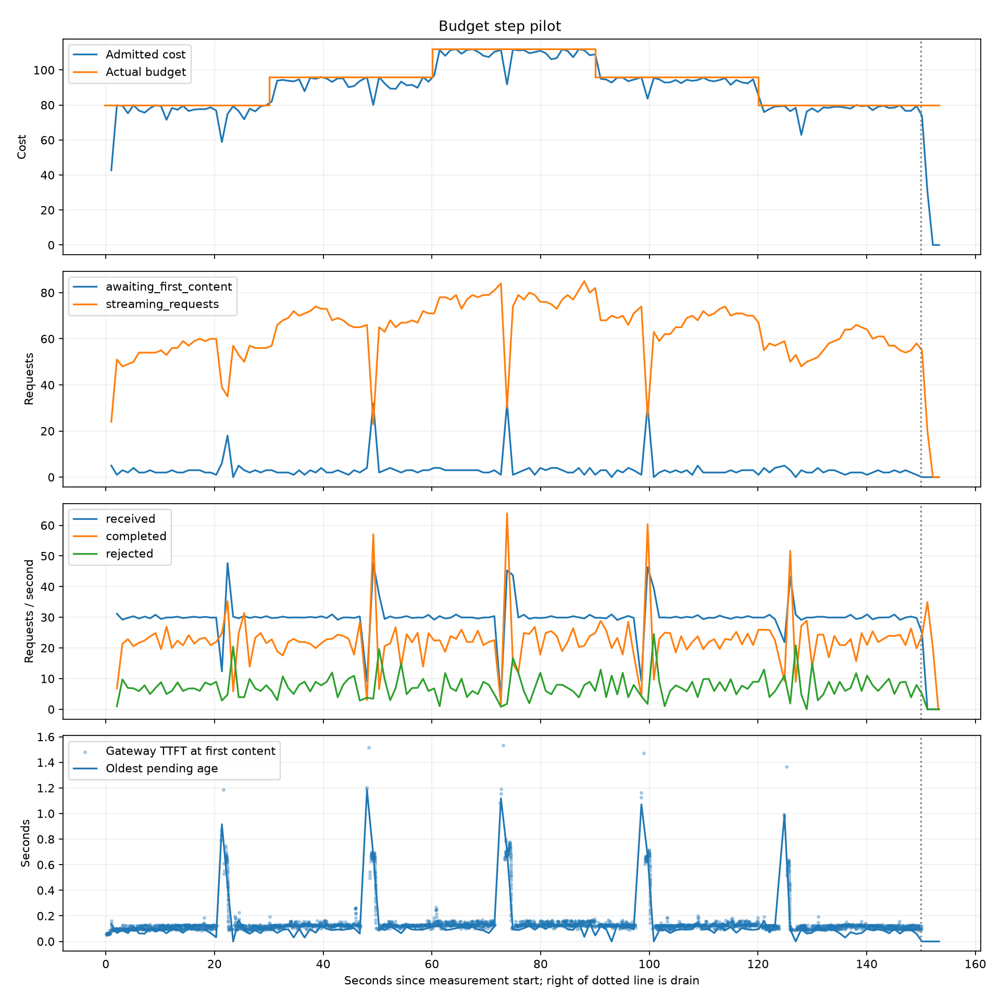

The validated repeat scheduled 4,500 measurement requests at 30 RPS: **3,402 succeeded, 1,098 were rejected (24.4%), and zero failed**. Client-observed P99 TTFT was **1.854 s**; P99 scheduling lag was **7.2 ms**. The run passed data-integrity validation, with no missing/duplicate IDs or telemetry loss.

This is a **step-response pilot, not evidence that MPC improves serving**. Budget changes visibly moved admitted cost and concurrent streaming work, but the run has only one sequence of budget steps and contains recurring latency spikes. More repeated runs and system-identification work are needed before fitting a predictive model or claiming a controller benefit.

Raw per-request records, gateway lifecycle events, warmup data, run manifest, budget acknowledgments, and validation report are in [results/pilot-02](results/pilot-02/). The earlier invalid run and low-rate smoke run should be added separately when their complete raw output is committed.


### Pilot diagnosis: separate gateway delay from serving delay

The offline analysis joins every measurement request to its gateway lifecycle by request ID. The slowest 35 successful requests (approximately 1%) averaged **2.021 s client TTFT**, of which **1.431 s (70.8%)** occurred between client start and gateway handler receipt. This attribution uses the same requests; percentiles of separate latency segments are not added or subtracted.

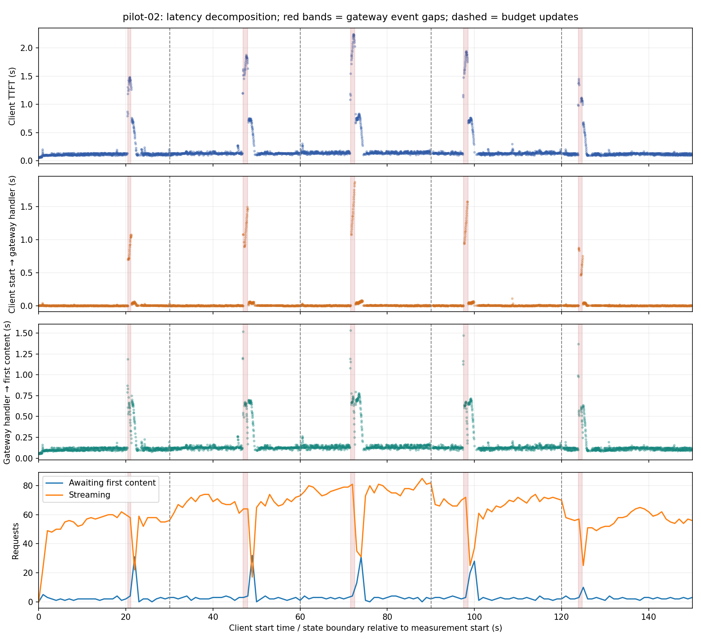

Five gateway event gaps lasted **0.67–1.09 s**, about 25–26 seconds apart. No snapshots were emitted inside the gaps, while the separate load process continued to start requests. These gaps did not coincide with budget changes. Gateway processing or host scheduling slowdown is consistent with the evidence, but the cause remains unconfirmed without event-loop, CPU, GC, and engine timing instrumentation.

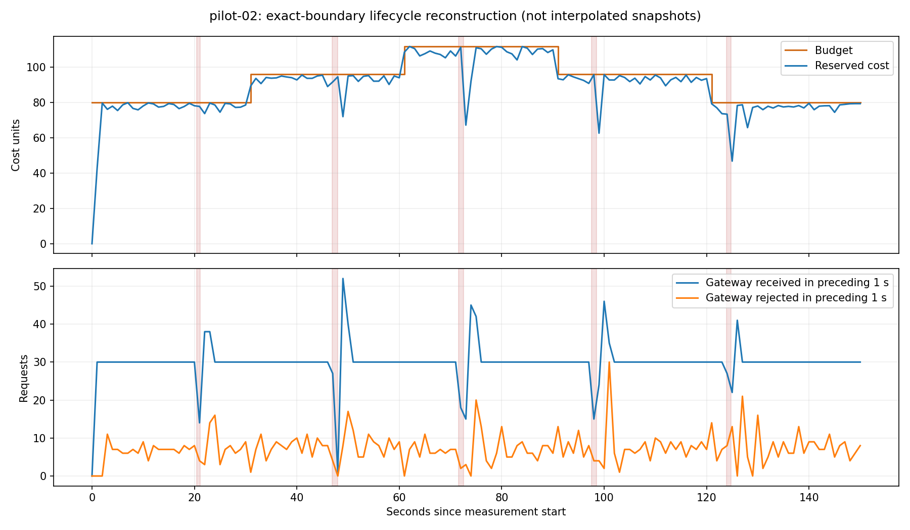

Higher budgets coincided with more streaming requests, but stage rejection rates were not monotonic. Lowering the budget from 112 to 96 and from 96 to 80 took **0.393 s** and **0.317 s**, respectively, for reserved cost to first fit the new limit; these are reservation-release times, not latency settling times.

The `long_output` workload requested up to **512 tokens** but successful requests generated only **93.9 tokens on average**, while its rejection rate was **51.6%**. Admission still reserved the output cap. This shows a cap/realized-length mismatch, not a measurement of true per-request GPU cost.

The current state signals are not yet validated for out-of-sample prediction. The next experiment will measure gateway event-loop lag, CPU/RSS, and GC pauses, and compare per-request versus shared upstream HTTP clients before collecting richer budget/load/mix excitation.

See the [full diagnosis](results/pilot-02-analysis/report.md), [aligned second-by-second data](results/pilot-02-analysis/aligned_seconds.csv), and [analysis summary with raw-file hashes](results/pilot-02-analysis/summary.json).

Reproduce without changing the raw pilot files:

```bash
python analyze_budget_dynamics.py results/pilot-02 \
  --output-dir results/pilot-02-analysis
```

The offline analysis requires NumPy and Matplotlib. This is one-run diagnosis; it does not demonstrate MPC performance improvement.


### RTX 4090 Azure replay: two budget-96 repeats

The Azure trace smoke and two five-minute repeats are now in
[results](results/). Both repeats replay exactly **7,643 requests** from the same
source window with variable input lengths, fixed budget 96, and a 128-token output
cap. Their raw integrity audits pass, but **both fail the predeclared 50 ms maximum
client scheduling-lag limit**. These are diagnostic results, not qualified MPC
benchmarks.

| Five-minute repeat | Successful / rejected / failed | Client P99 TTFT | Scheduled-arrival SLO goodput | Maximum client scheduling lag |
|---|---|---|---|---|
| r1 | 2,239 / 5,404 / 0 | 2.489 s | 2.403 requests/s | 208.07 ms |
| r2 | 2,220 / 5,423 / 0 | 2.945 s | 2.197 requests/s | 175.38 ms |

The slowest 23 successful requests in each repeat spend **97.7% / 97.9%** of
their mean client TTFT between dispatch and gateway first content. That stage
includes transport, engine queue/compute, and gateway scheduling; it is not a
GPU-only measurement. None of those tail stages overlaps the selected large
loop-monitor delay intervals.

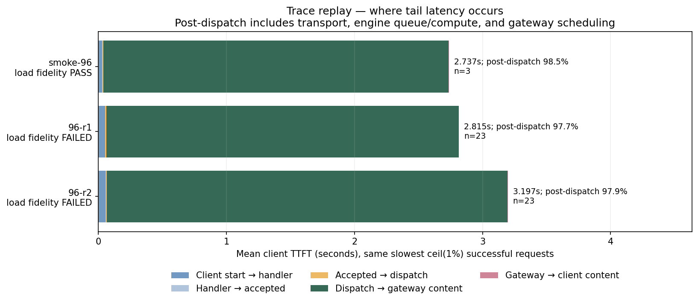

Each repeat has four gateway monitor delays above 300 ms. Between their nearby
lifecycle gaps, accepted-count increments are **472–524 requests**, while time
spacings vary. This is a work-count-related hypothesis to investigate, not a
confirmed GC or HTTP-client cause. Generator scheduling delays also occur away
from gateway pauses. Every successful request generated exactly 128 tokens, so
these runs do not yet cover variable decode demand.

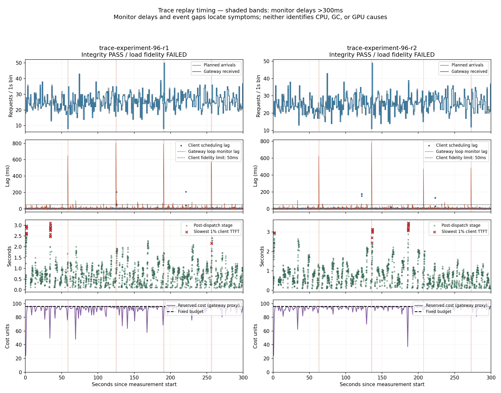

The [full diagnosis and next experiment design](results/trace-budget96-analysis/report.md)
and [audited summary with raw hashes](results/trace-budget96-analysis/summary.json)
separate observations from causal hypotheses. Next: qualify offered-load replay,
sweep fixed budgets on the same GPU/configuration, then identify budget-response
dynamics before comparing MPC with fixed and reactive baselines.

Reproduce offline without changing raw reports:

```bash
python analyze_trace_dynamics.py \
  results/trace-smoke-96 \
  results/trace-experiment-96-r1 \
  results/trace-experiment-96-r2 \
  --output-dir results/trace-budget96-analysis
```
