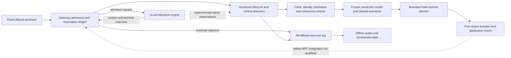

# Serving and control architecture

Status: implemented serving/instrumentation and CPU research components;
the complete native MPC loop is **not yet qualified**.

Solid arrows describe serving flow or implemented component interfaces, not
proof that the full diagram has run as an integrated controller. The dashed
actuator edge is the principal missing native closed-loop evidence.

## Ownership and extension points

| Layer | Responsibility | Repository evidence |
|---|---|---|
| vLLM | Model execution, native batching and cache management. | External backend; do not claim these algorithms as project contributions. |
| Gateway | Reservation accounting, admission/rejection, streaming lifecycle and cleanup. | [`gateway.py`](../gateway.py) |
| Measurement | Scheduled arrivals, actual applications, request/state/diagnostic records. | [`trace_control.py`](../trace_control.py), [`telemetry.py`](../telemetry.py), E1 in [results](benchmark_results.md) |
| Public prediction/planning library | Experimental scenario rollouts and policy selection. | [`mpc_lab/model.py`](../mpc_lab/model.py), [`mpc_lab/controller.py`](../mpc_lab/controller.py); not the E2 tested implementation |
| Frozen team16 planner | Exact candidate ordering and numerical/deadline/version controls, within its accepted scope. | E2 frozen `policy_planner16.py`; runtime integration not accepted |
| Runtime/actuation | Observation guards, pending-command handling and first-action coordination. | [`mpc_lab/runtime.py`](../mpc_lab/runtime.py), [`mpc_lab/actuator.py`](../mpc_lab/actuator.py); native qualification pending |
| Evaluation | All-offered scoring, failure retention and baseline accounting. | [`mpc_lab/benchmark.py`](../mpc_lab/benchmark.py), accepted research evidence; no completed current native comparison |

The public library and frozen team16 prototypes are separate versions. Do not
combine their settings, interfaces or test totals into one allegedly deployed
implementation.

The selected MVP continuation is isolated in
[`experiments/mpc-research/resume-mvp`](../experiments/mpc-research/resume-mvp):
`nominal_planner.py` provides typed finite-horizon planning,
`nominal_scenario.py` generates Train-only nominal forecasts, and
`nominal_permit.py` supplies a separate default-OFF experimental guard.
Runtime wiring, request-outcome recording and service ownership are still
under integration; no native qualification follows from those source files.
The blocked legacy launcher is not a prerequisite to this isolated path.

Current source links are reading aids, not proof of the implementation measured
in E1. E1 used the manifest-recorded runtime hashes with `git_dirty=true`;
attribution to current files requires matching those hashes. E2 tested the
frozen team16 planner with SHA256
`164f3947b71392112e0672b4ae0aab6f602c3380d1f4a61a63f14766ee10db6a`,
not the public `mpc_lab` modules.

## State and actuator semantics

Gateway observations include immutable request reservation costs, reserved work
R, awaiting-first-content Q, streaming D, ages and arrival/outcome history.
These are gateway state/proxies, **not observed remaining GPU work**.
Native scheduler/copy-ready information needs its own source-clock and
availability qualification.

The controlled value is a gateway weighted reservation budget u. Admission
requires `R + request_cost <= u`; terminal cleanup releases that request's
reservation. A lower budget does not evict already admitted work. An increase
does not itself submit a request. Gateway release is not proof that cancelled
backend computation stopped.

## Prediction and optimization

The reference specification maximizes expected completed SLO-good request count
over a fixed offered cohort using a common scenario panel. Rejected, failed or
unresolved requests receive no positive success credit. Candidate plans use the
same model, objective, resource constraints and scoring population.

Fixed holds one budget. Strong OneMove can choose the best permitted single
transition, including a delayed transition; it is not a deliberately weak
one-step forecast. MPC can consider multiple future actions but executes only
the first, then reobserves. The accepted frozen planner's exact limits belong to
its own PLAN, not a universal horizon setting.

See the [mathematical specification](../experiments/mpc-research/mpc-mathematical-specification.md)
and E2 for configuration-specific details. Native14 is a separate failed-
qualification model; a source-faithful formula is not evidence of predictive
accuracy or calibrated uncertainty.

For the isolated nominal MVP (E6/E8), the planner scores model-resolved
successful requests meeting the TTFT threshold. This proxy is not the measured
natural-SLO scorer. A frozen Train-only prior generates shared candidate inputs;
uncalibrated service/output assumptions and stationary arrivals can extend
beyond the public offered window. The separate measured scorer remains
unchanged. Neither CPU validation nor causal input selection proves prediction
accuracy or a native MPC benefit.

## Runtime contracts and unresolved failure paths

Reject stale, incoherent, wrong-clock or wrong-version observations. Bound
search and account for observation, serialization, IPC, solver, logging and
application delay. An unresolved command timeout means unknown application,
not cancellation; do not send speculative replacements.

Process exit must include owned roots/leaves/readers/helpers and a truthful
final receipt. Pre-return metadata is not proof of completed cleanup. D2-F1
identifies a source-backed path where a pending alarm, cleanup-anchor
publication failure or clock error can skip cleanup, after which the exclusive
lock can be released while owned processes may still be alive. This is not an
observed live orphan incident. That launcher is not live-eligible until its
repair is accepted.

Admission/resource bounds are not end-to-end latency guarantees, universal
queueing stability, physical KV safety or production reliability certification.
