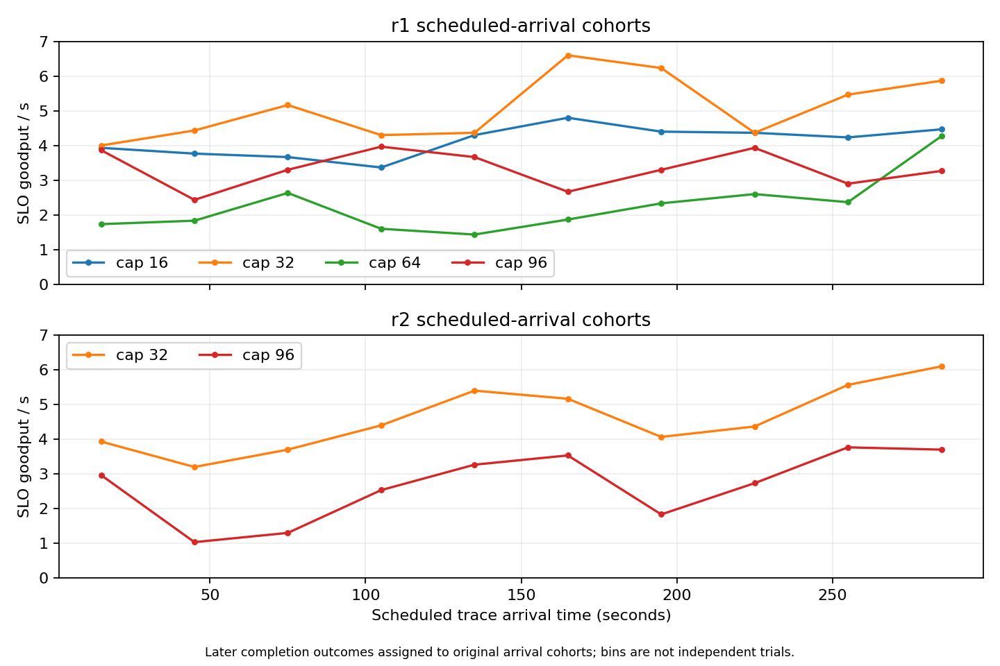

# Same-host fixed-cap range study — partial attempt

Collected **2026-10-20 UTC / 2026-10-19 America/Los_Angeles** on one RTX 4090.
Runtime: `31f1079d47a30b390e5df02095a694688b90f8a9`; driver 595.91.07;
Qwen/Qwen3-4B-Instruct-2507, context 8192, prefix cache disabled.

**The original suite failed and remains incomplete.** Smoke and six full-trace
captures pass all six enabled gates. Cap16-r2 completed collection but failed
load fidelity and external diagnostic integrity. Cap64-r2 was never started.
This publication preserves every original file and does not promote the suite,
retry a failed run, change thresholds, collect C, fit a model or run MPC.

## Question and method

The previous shared-client A/B excitation used caps48–96 and different hosts.
This study asks whether lower fixed reservation caps offer a more useful
operating region, and whether full-run results repeat on the same host.

- Frozen declaration: [cap-range-v1](../../experiments/cap-range-v1.json).
- Planned fixed-cap order: **64/16/96/32 → 32/96/16/64**, 300 arrival seconds each.
- One unchanged live backend; three consecutive idle samples before/after each
  completed replay, fresh gateway and three drained warmups per run.
- Same 7,643 offered trace IDs, arrival times and input lengths; synthetic text,
  output cap128 with natural EOS. Historical output lengths are not replayed.
- Unchanged V1 cost coefficients, shared upstream client, process sampler,
  gateway/runner diagnostics and bounded runner GC deferral (1536 MiB).
- Goodput = completed streams whose first content arrives within 0.5 seconds
  **of scheduled arrival**, divided by all 300 arrival seconds. First 30 seconds,
  rejected arrivals and failed requests are retained in the whole-run evaluation.
- Maximum load/control scheduling limits remain 50 ms.

Mirror order balances linear ordinal drift only. Cap 32 repeats are adjacent.
Arbitrary host/thermal drift, engine state and stochastic outcomes remain possible;
two repeats are not a confidence interval or a reliable noise-floor estimate.

## Qualified full-run outcomes

| Cap / repeat | Success / rejected / failed | SLO successes | Goodput /s | Scheduled P99 TTFT | Rejected | SLO / successful |
|---|---|---:|---:|---:|---:|---:|
| 16 r1 | 1268 /6375 /0 | 1239 | 4.130 | 0.592s | 83.41% | 97.71% |
| 32 r1 | 1752 /5891 /0 | 1524 | **5.080** | 0.837s | 77.08% | 86.99% |
| 32 r2 | 1706 /5937 /0 | 1377 | **4.590** | 0.978s | 77.68% | 80.72% |
| 64 r1 | 1954 /5688 /1 | 680 | 2.267 | 1.954s | 74.42% | 34.80% |
| 96 r1 | 2183 /5460 /0 | 999 | 3.330 | 2.144s | 71.44% | 45.76% |
| 96 r2 | 2225 /5418 /0 | 800 | 2.667 | 2.460s | 70.89% | 35.96% |


Cap 32's two-run mean is 4.835/s versus 2.998/s for cap 96: **61.26% higher observed
goodput** in these development captures. Even the lower cap 32 result exceeds
the higher cap 96 result by 37.84%. This is descriptive, not a causal improvement
estimate, significance test, controller result or global optimum.

The mechanism is consistent with admission tradeoffs: cap 16 rejects more than
83% of arrivals but almost all completed streams meet TTFT; cap 96 completes more
streams but most miss TTFT. Cap 32 lies between them in these observations.
**Cap 32 does not achieve P99 TTFT≤0.5 s.** Maximizing the count of SLO-compliant
streams is different from enforcing an admitted-request percentile guarantee.

## Matched arrival cohorts and request sizes



For each repeat, compare corresponding 30 s scheduled-arrival cohorts against cap 96.
Cap 32 has more eventual SLO successes in all 10 cohorts of r1 and all 10 of r2.
All offered trace IDs are retained; cohort membership uses original trace time,
not completion time. These 20 bins are correlated portions of four captures,
not 20 independent trials or matched internal serving states.

| Comparison | Both SLO-good | Only cap 32 good | Only comparison cap good | Cap 32 winning cohorts |
|---|---:|---:|---:|---:|
| r1:32 vs16 | 388 | 1136 | 851 | 9/10; one tie |
| r1:32 vs64 | 191 | 1333 | 489 | 10/10 |
| r1:32 vs96 | 286 | 1238 | 713 | 10/10 |
| r2:32 vs96 | 221 | 1156 | 579 | 10/10 |

Cap 32 also has more SLO successes than corresponding cap 96 runs in each input-size
stratum (short/medium/long). This does not prove absence of starvation or equal
service: cap16-r1 has 61 short-input SLO successes versus 58 for either cap 32 run,
and there are only 184 offered short-input requests. Full strata remain in
[summary.json](summary.json); no fairness guarantee is inferred.

## Why cap16-r2 failed

The run completed all 7,643 requests (1220 success,6423 reject,0 failed), with 1160 SLO
successes and 3.867/s descriptive goodput. **Exclude it from qualified comparisons**:
maximum client scheduling lag 431.71 ms exceeds50ms, and one external sample fails.
The collector closes normally: 301 samples, 1 sample error, 0 write errors.

Times below are seconds from this run's measurement start:

| Time | Observation |
|---|---|
| 96.338–102.193 | Gateway loop monitor due/resumed interval;5.855s delay. |
| 96.747–98.750 | External GET vLLM `/metrics` times out after 2.003 s, before headers. |
| 102.246–104.050 | Scheduled-arrival range of 37 launches delayed>50ms; all 37 rejected. |

No gateway GC span overlaps the monitor delay. Nearby diagnostic CPU samples are
6.602s apart with only 0.123 s additional process CPU and 0.121 s loop-thread CPU.
The runner continues to emit loop observations while the gateway has no events;
its largest measurement loop delay is 318.88 ms during the recovery period.
At trace second 102 the gateway handles 182 received requests, including 173
rejections, consistent with a recovery backlog. This is temporal evidence,
not proof that gateway recovery caused every runner delay.

The data do not support labeling this long pause as gateway GC or heavy Python
CPU work. Blocking I/O or OS scheduling are hypotheses; no syscall/off-CPU trace
or cgroup throttling evidence identifies the root cause. The metrics timeout is
on the vLLM endpoint, so it does not by itself prove a gateway cause. Increasing
the metrics timeout would not repair the separate load-fidelity failure.

## One cap64-r1 failed request

Trace ID `242489b81db35abe:4925`, scheduled at 134.911 s, was admitted and failed
during upstream HTTP send/headers with `ReadError`. The client receives HTTP 502
after about 10.75 ms; no first content was observed. Request diagnostics confirm
reservation release and cleanup. It remains counted as failed and contributes
zero goodput. Complete accounting can pass integrity gates despite a real service
failure; PASS never meant every request succeeded. Exact lifecycle is retained
in summary and the original archive.

## Evidence and reproduction

- [Original suite](suite.json), still `status=failed`, `valid=false`.
- [Browsing captures](captures/): byte-identical manifest/report/time-series files.
- [Native CPU acceptance](native-cpu/acceptance.json): 504 cases, 0 failures/errors/skips;
  exact runtime revision. [JUnit](native-cpu/junit.xml) and packages are retained.
- [Raw archive index](raw-bundle/manifest.json): 161 original files,115,665,187 upload
  bytes, split into 56 parts without recompressing. SHA256:
  `1cfa90db960135ef6ea2d8635c36f0d45bfbb1417313eafa99278e31e85891cb`.
- [Recomputed verification and results](summary.json): all 8 reports independently
  reproduce with the original auditor; 119 supervisor-registered hashes match.
  All 161 original files, including the failed run and logs not fingerprinted by the
  failed supervisor entry, additionally have archive-inventory hashes.
- Capture manifests retain `git_dirty=true`; supervisor checked tracked cleanliness
  and the recorded runtime source hashes match the repository. Do not rewrite the
  original provenance flag into a claim of a completely clean working directory.

Use a checkout of this publication commit so the recorded runtime source hashes
match. From repository root, using Python 3.12 and the existing CPU dependencies
plus Matplotlib (no GPU/server needed):

```bash
python results/cap-range-20261020/extract_bundle.py --output-dir /tmp/cap-range-original
python results/cap-range-20261020/reproduce.py \
  --raw-root /tmp/cap-range-original --output-dir /tmp/cap-range-analysis
```

Use fresh destinations. The helper verifies each part, the reconstructed original
archive and all 161 members before extracting. The reproducer verifies source hashes,
native CPU evidence and original files, re-audits all 8 captures in temporary views,
and rebuilds summary plus figures. Raw reports are never overwritten.

The strict full-suite `analyze_cap_sweep.py` is intentionally not used to turn this
partial attempt into an accepted suite. This supplemental analysis explicitly
retains incompleteness. Held-out C remains uncollected/unscored; no model/MPC
acceptance follows. Cap 32 is a candidate fixed baseline. Low-cap switching dynamics
and generalization require separate evidence; completing two qualified repeats
per cap would still require separately declared supplemental captures.
