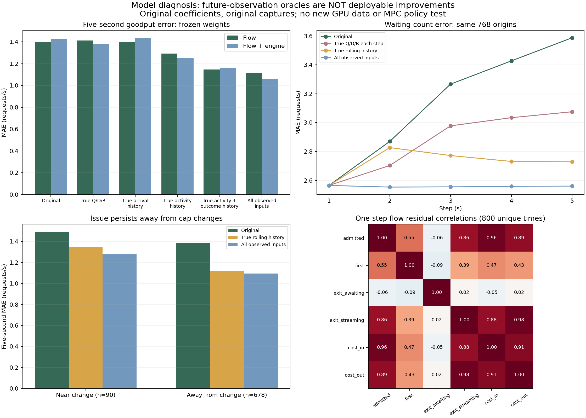

# Frozen-model diagnosis: incomplete history dynamics, not just state drift

The original flow model advances Q/D/reserved-cost, but leaves seven rolling
history predictors and engine observations fixed at the rollout origin. The
reward head still depends on those predictors. This is a concrete structural
approximation: the rollout does not evolve all the endogenous information used
by its own prediction heads.

A frozen-coefficient diagnostic now shows where that approximation matters. It
also narrows earlier claims: **perfect Q/D/R alone does not repair goodput
prediction**, and missing 16↔32 switching data is not an established cause of the
observed error. We should first test a model that evolves its histories and
couples flows coherently before deciding on additional GPU measurement.

## Fixed evidence and diagnostic boundaries

- Existing eight qualified captures, verified cached tables, original chronological
  training cutoffs and label-availability purges. No new raw audit or GPU run in
  this invocation; original raw/table provenance is retained by the cache.
- Both archived flow models are refitted with the same data and coefficients
  checked to tolerance 1e-10. All 1,536 original five-step forecasts and cumulative
  projection corrections reproduce (768 origins × two models).
- Fourteen modes change only rollout observations or replace selected flow heads
  with measured future values. There is no retraining, parameter search, new
  model selection, C usage or live controller.
- Every refresh/reset/flow oracle uses future information unavailable at the
  original decision. These are **not deployable gains, causal attribution,
  attainable accuracy bounds or evidence for an MPC policy**. Oracle groups
  interact and must not be added as independent error contributions.
- All five-step state targets and sums of disjoint one-second cohort rewards
  reconcile with original 1/2/5-second labels. Shorter-step curves use the same
  768 five-second-eligible origins, unlike original full-horizon tests.

## 1. Goodput needs more than corrected Q/D/R

Five-second future-arrival-cohort SLO-goodput rate MAE (requests/s):

| Rollout diagnostic | Flow | Flow + engine |
|---|---:|---:|
| Original frozen-history rollout | 1.3962 | 1.4275 |
| Reset Q/D/R to truth at each step | 1.4128 | 1.3776 |
| Refresh arrival history only | 1.3952 | 1.4338 |
| Refresh engine observations only | 1.3962* | 1.4360 |
| Refresh activity history only | 1.2919 | 1.2512 |
| Refresh resolved-outcome history only | 1.4428 | 1.5177 |
| Refresh activity + outcome histories | 1.1451 | 1.1613 |
| Refresh all rolling histories | 1.1476 | 1.1690 |
| Reset all model input observations | 1.1170 | 1.0613 |

*Engine fields are not inputs to the first model, so its engine-only refresh is
an exact negative control.

History groups are fixed by the existing input schema:

- Arrival: received count and offered cost over five seconds.
- Activity: accepted input tokens, first-content count and completion count.
- Outcomes: resolved TTFT-met and resolved admitted-missed counts.

Updating endogenous activity and outcome histories together makes the largest
observed historical-input improvement; outcome refresh alone worsens error. This
is a joint information result, not proof that a single history channel is a root
physical cause. Future outcomes may reveal parts of the target workload, so their
oracle value cannot be treated as a realizable online feature update.

The experiment rejects the simple explanation that goodput error is primarily
repaired by accurate Q/D/R propagation. It supports investigating a missing
history/cohort state representation. Future arrival-history or gauge refresh
alone does not improve these fixed heads; that does not prove arrivals or engine
state are unimportant to the real system or to other models.

For context, repeatedly evaluating the origin-state reward head under each
planned cap, without advancing Q/D/R, scores 1.5515 / 1.5009. Advancing predicted
states therefore does help relative to that simple comparator. The failure of
truth-state resets to improve further can include compensating model errors;
it does not show that physical states are irrelevant.

## 2. Waiting-state error does accumulate, with stale history contributing

For the model without gauges, waiting-count MAE on matched origins:

| Step | Original rollout | Truth Q/D/R each step | Truth history | All observed inputs |
|---|---:|---:|---:|---:|
| 1 | 2.5652 | 2.5652 | 2.5652 | 2.5652 |
| 2 | 2.8700 | 2.7033 | 2.8273 | 2.5539 |
| 3 | 3.2665 | 2.9777 | 2.7721 | 2.5554 |
| 4 | 3.4273 | 3.0342 | 2.7314 | 2.5589 |
| 5 | 3.5875 | 3.0753 | 2.7290 | 2.5609 |

The gauge model grows from 2.5880 to 4.6197; resetting state gives 3.4846,
refreshing history gives 3.7404, and resetting all observations gives 2.6098 at
step five. Both predicted-state drift and stale auxiliary inputs matter for
waiting-state prediction in these oracles. Their effects are not additive.

## 3. Small net reservation error hides large flow errors

At 800 unique observed-input decision times, the basic model's one-second
cost-in/out MAEs are 6.3726 and 7.1488 cost units. Their residual correlation is
0.9117 (gauge version 0.9113). Since reservation uses cost-in minus cost-out,
shared error can cancel. A reasonable net-reservation prediction is therefore
insufficient evidence that either component flow has been identified accurately.

Replacing only admission/cost-in with truth increases five-step reserved-cost
MAE from 2.4075 to 15.0394; replacing only terminal flows gives 11.4308. Replacing
all flows reconstructs every state exactly. Partial replacements can violate
learned balances and trigger the unchanged feasibility projection, so these are
not independent error contributions. They motivate joint/coherent flow modeling,
not a claim that better admission measurements physically worsen the system.

## 4. The limitation is also present away from cap changes

For basic flow, five-second goodput rate MAE:

| Subset | Original | Truth histories | All observed inputs |
|---|---:|---:|---:|
| Near cap changes (90 overlapping origins) | 1.4893 | 1.3495 | 1.2803 |
| Away from cap changes (678 origins) | 1.3838 | 1.1208 | 1.0954 |

Refreshing histories improves the pooled five-second goodput error in every one
of the eight runs for both model variants. These windows/repeats share the same
arrival workload and are not independent significance samples. The issue occurs
in fixed-cap runs as well: lack of low-cap switching examples alone does not
explain it. Low-cap switching readiness still remains unverified.



## Next implementation question

First test an **origin-information-only** augmented transition state that evolves
rolling activity histories and delayed cohort outcomes, with coherent admission,
first-content, terminal and cost flows. Resolved-goodput history must account for
completion delay; simply appending a predicted arrival-cohort reward as an
immediate completion is invalid. Arrival history needs an explicit forecast or
scenario assumption. True future refreshes stay confined to this diagnostic.

Compare that candidate against the unchanged direct/no-plan and flow baselines on
whole-run development holdouts. If improvements fail, inspect representation,
forecast uncertainty, functional form and support before collecting targeted
new data. This diagnosis does not yet deliver that causal predictor, prove a
unique physical root cause, certify low-cap action ranking or validate MPC.

## Reproduce and inspect

Python 3.12 plus the repository CPU dependencies:

```bash
python results/flow-diagnosis-20261020/reproduce.py --output-dir /tmp/flow-diagnostic-repro
```

The helper verifies source/archive/cache hashes, restores the existing derived
pack, checks original coefficients/forecasts/projection corrections and repeats
all diagnostic scores and predictions. It refuses existing output. Cached
reproduction is not a fresh raw audit.

[Summary](summary.json) · [Complete metrics](metrics.csv) ·
[Compressed report and per-origin predictions](full-report.json.gz) ·
[Validation](validation.json)

262 related offline tests pass, including future-observation isolation, oracle
feature-group separation, label partitioning and nonmutation tests. Full native
CPU acceptance remains outstanding as recorded in the parent review; this
analysis does not bypass the PID/procfs preflight or claim a new native pass.
