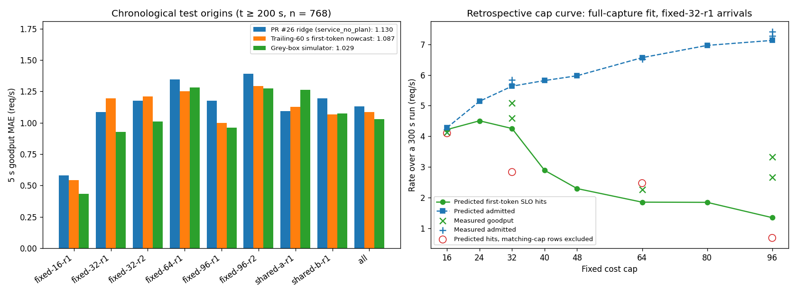

# Grey-box simulator: corrected chronological evaluation (revision 2)

CPU-only development analysis on the same eight qualified captures and **768** chronological
five-second origins (t >= 200 s) as the [combined review](../service-review-20261020/report.md).
**No new GPU measurements, no C data, and no controller.** All errors are goodput-rate MAE in req/s.



## Review corrections

- **Request identity:** carry `request_id` through arrivals, simulation and residual matching.
  Scheduled timestamps are not unique identifiers. Stable sorting preserves input order for tied
  arrivals instead of ordering ties by cost. The eight current captures have no duplicated
  scheduled timestamps; the collision test protects future captures.
- **Decision availability:** rejected request cost/input length becomes usable at `rejected`,
  not at `received`. A receipt can precede the decision that records those attributes.
- **Scrape availability:** a value must be received and parsing finished by the cutoff. A scrape
  sent before 200 s but available after 200 s cannot calibrate the model. Failed samples remain
  barriers; counter regressions, epoch changes and exporter changes cannot form training intervals.
- **Complete calibration windows:** each historical oracle simulation is censored at its own
  origin + 5 s horizon + 0.8 s drain. Calibration uses only windows fully observed by 200 s;
  latest availability is **199.8 s**, with **23,366** residual rows. Late decisions and first
  tokens are omitted. Online bias waits until the whole historical window is available, using
  older aligned windows when necessary. These overlapping rows are not independent samples.
- **Admission counts:** include accepted requests still awaiting first content at simulation end;
  unreached decisions remain explicitly unknown.
- **Numerical guards:** reject nonphysical step coefficients, retain unresolved requests awaiting
  first content, and impose an explicit 1 ms floor on residual spread to prevent division by zero.
- **Interpretation:** replicate discrepancy is observed variability, not an irreducible noise
  floor. Aggregate engine histograms do not provide exclusive per-request latency attribution.

The scorer also rejects source changes during evaluation. Tests mutate information available only
beyond the training cutoff and require identical fitted parameters and training residuals.

## Model and assumptions

[`greybox_simulator.py`](../../greybox_simulator.py) uses the gateway admission inequality
`reserved + request_cost <= cap` and completion-time reservation release. This is a known rule
inside a simplified simulator, **not an exact reproduction of gateway/engine scheduling**.

The engine approximation uses an assumed 8,192-token step budget, one decode token per running
request per step and FIFO prefill. A fitted step takes 9.18 ms + 0.317 ms/decode token +
0.0534 ms/prompt token. Fitting uses only completed, available scrapes before the training cutoff.
The 8,192-token scheduler budget is a modeling assumption; it is distinct from the model's
8,192-token context limit. Fixed 128-token output lengths match these captures.

The origin reconstructs admitted requests from observed lifecycle events. Remaining decode work
is approximated using available aggregate iteration counters. Requests still awaiting first
content restart with their estimated full prompt: partial prefill progress is unobserved.
Lifecycle visibility assumes a co-located reader; no online feature transport is validated here.

Future arrival scenarios replay 16 random past five-second windows from the previous 60 s,
using only requests whose gateway decisions are already known. A nondecreasing concurrency-to-TTFT
residual curve and robust spread calibrate the step model; online bias uses closed, past windows.
This correction is empirical, not a causal queueing model or a latency guarantee.

The simulator estimates first-token SLO hits. Scoring uses archived cohorts that eventually
complete successfully; terminal failure behavior is not modeled. Likewise, the nowcast counts
already-observed first-token hits, without looking ahead to eventual completion. These proxies
must not be described as already-completed goodput available at decision time.

## Corrected forecast results

| Model | MAE | Bias | Within-run correlation |
|---|---:|---:|---:|
| Ridge (`service_no_plan`) | 1.1304 | -0.375 | 0.23 |
| Trailing-60 s first-token nowcast | 1.0865 | -0.259 | 0.05 |
| Simulator | 1.0286 | -0.102 | 0.31 |
| Simulator, no online bias | 1.0510 | -0.163 | 0.32 |
| Diagnostic oracle arrivals, raw step TTFT | 1.8575 | +1.548 | 0.42 |
| Diagnostic oracle arrivals + overhead | 1.0233 | -0.104 | 0.41 |
| Diagnostic oracle arrivals + overhead + bias | 1.0037 | -0.043 | 0.39 |
| Each run’s own test mean (oracle) | 1.0769 | +0.000 | 0.00 |

Simulator minus ridge: **-0.102**, conditional 95% interval
**(-0.183, -0.023)**. Simulator minus nowcast:
**-0.058**, interval **(-0.120, +0.005)**.
The latter includes zero; these results do not establish a clear advantage over the nowcast.

Intervals resample 10 s blocks within each run (4,000 replicates). They are conditional development
summaries for these runs and this trace, not independent acceptance evidence. Dependence beyond
10 s and common trace structure remain limitations; no block-length selection was performed.

| Run | Ridge | Nowcast | Simulator |
|---|---:|---:|---:|
| fixed-16-r1 | 0.579 | 0.541 | 0.435 |
| fixed-32-r1 | 1.085 | 1.197 | 0.927 |
| fixed-32-r2 | 1.176 | 1.211 | 1.009 |
| fixed-64-r1 | 1.345 | 1.253 | 1.284 |
| fixed-96-r1 | 1.175 | 1.001 | 0.962 |
| fixed-96-r2 | 1.393 | 1.293 | 1.274 |
| shared-a-r1 | 1.094 | 1.129 | 1.263 |
| shared-b-r1 | 1.195 | 1.067 | 1.074 |

The simulator beats ridge on 7/8 runs, with shared-a the exception. Near cap changes in shared A/B
(n = 96), MAE is **1.414** versus ridge **1.240**.
In steady A/B segments (n = 96), simulator MAE is 0.924, ridge 1.049 and nowcast 0.838.
These are retrospective forecast comparisons, not policy outcomes.

Same-cap replicates have correlations 0.10 (32) and 0.04 (96), and paired discrepancy MAE
1.40 / 1.62. This can include hidden state, drift, host/runtime effects and missing predictors.
It does **not** identify an intrinsic error floor. Oracle arrivals improve this particular
calibrated model only modestly; that does not establish that arrival uncertainty is generally
unimportant.

## Cap-choice diagnostic remains inadequate

This separate retrospective diagnostic fits step/overhead relationships across the full first
300 s, rather than using the chronological 200 s training boundary. It simulates a 300 s run
from idle, with fixed-32-r1 arrivals and schedule-to-accept delay calibrated from its first 200 s.
It uses measured request costs, so it is not a deployable workload forecast.

| Cap | Predicted admitted | Predicted SLO hits | Measured goodput | Predicted SLO hits, matching cap excluded from fits |
|---|---:|---:|---:|---:|
| 16 | 4.28 | 4.22 | 4.13 | 4.10 |
| 24 | 5.14 | 4.50 | — | — |
| 32 | 5.63 | 4.25 | 5.08 / 4.59 | 2.83 |
| 40 | 5.82 | 2.89 | — | — |
| 48 | 5.97 | 2.29 | — | — |
| 64 | 6.56 | 1.85 | 2.27 | 2.47 |
| 80 | 6.96 | 1.84 | — | — |
| 96 | 7.13 | 1.35 | 3.33 / 2.67 | 0.68 |

Admissions are within about 4% of measured values at measured caps, while goodput remains poorly
calibrated. The unmeasured predicted peak at 24 is not an established optimum. Excluding matching
cap observations is a sensitivity analysis: shared trajectories can retain history from that cap,
and the reference delay remains calibrated on fixed-32-r1. It is not a pure causal cap holdout.

## Engine observations: supporting association, not exclusive attribution

| Run (capture order) | Queue time | Prefill time | Engine TTFT | Gateway TTFT |
|---|---:|---:|---:|---:|
| fixed-16-r1 | 0.009 | 0.117 | 0.146 | 0.154 |
| fixed-32-r1 | 0.037 | 0.172 | 0.236 | 0.246 |
| fixed-32-r2 | 0.061 | 0.192 | 0.281 | 0.290 |
| fixed-64-r1 | 0.304 | 0.293 | 0.651 | 0.669 |
| fixed-96-r1 | 0.228 | 0.291 | 0.559 | 0.583 |
| fixed-96-r2 | 0.337 | 0.304 | 0.683 | 0.696 |
| shared-a-r1 | 0.391 | 0.314 | 0.746 | 0.772 |
| shared-b-r1 | 0.327 | 0.296 | 0.665 | 0.688 |

Higher-cap runs tend to have larger recorded engine queue/prefill means, with no recorded
preemptions or prefix hits. This is consistent with engine queueing contributing to TTFT.
Engine histograms count observations in a scrape interval; gateway means select successful
requests by admission time. Their populations are not exactly aligned. Close aggregate means
therefore cannot rule out frontend/gateway delay or identify per-request GPU execution time.
Run order and residual system state are also confounded.

## What to do before another GPU rental

1. Keep this corrected model as a candidate and compare existing fixed-cap and switch errors.
   It does not yet establish reliable action ranking or justify enabling MPC.
2. If low-cap transition response remains the decision-critical gap, freeze a small repeated,
   bidirectional **16 <-> 32** validation on one host, with fixed-cap references and a declared
   model before collection. Fixed 16 and 32 already exist; their switching transient does not.
   Missing switches are **not a proven cause** of the existing model error.
3. Extra fixed 24/40/48 points, broader switching, request-linked engine spans, randomized order,
   more replicates and new workloads are conditional follow-ups, not a mandatory full rental
   suite. Not every possible cap pair needs measurement.

## Validation and reproduction

- **33 grey-box tests pass**, including request-ID collisions, tied ordering, rejection decision
  timing, post-cut parameter invariance, scrape availability/reset barriers and numerical guards.
- **295 related offline tests pass** across nine modules (including the 33 above).
- Every consumed raw file matches the archived review's SHA-256; actual counts match all 768
  archived origins. This reuses the earlier capture qualification and does not rerun every
  original capture gate.
- Full score reproduction compares all numeric and structural report fields with tolerance
  1e-9, including source fingerprints. See [validation.json](validation.json).
- No new full native CPU/mock acceptance or live GPU/MPC validation is claimed.

```bash
python results/greybox-forecast-20261020/reproduce.py --output-dir /tmp/greybox-reproduction
python results/greybox-forecast-20261020/plot.py
python -m pytest tests/test_greybox_simulator.py -q
```

To reuse already-extracted captures, supply both `--cap-range-dir` and `--shared-client-dir`
to `reproduce.py`; the scorer still checks every consumed raw file hash. Default reproduction
re-extracts and verifies the archived bundles on Linux/macOS.

## Change from the original PR #28 report

The [original revision](https://github.com/dlinlabs/vllm-serving-lab/tree/18a5c06fad6e658b0ab68b6f6a8b573ddf1355ce/results/greybox-forecast-20261020)
reported simulator MAE **1.0196** and near-change MAE **1.357**. Corrected values are
**1.0286** and **1.414**. The simulator-vs-nowcast interval now crosses zero. The training
window, availability and bias changes are correctness fixes, not parameter tuning to improve
scores; no new capture or held-out C data was used.
