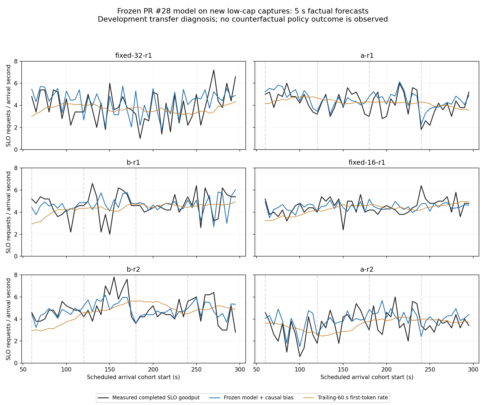

# Frozen PR #28 model on new 16/32 captures

The archived model predicts the new low-cap captures better than its trailing-60-second
first-token baseline. This supports factual short-horizon forecasting, **not a demonstrated
ability to choose a cap that beats the best fixed policy**. No controller was executed and
no model was refitted to these captures.

## Provenance and qualification

- Model source: `ca919b0526bda1f32218b5f202b4a4dc7a7f2b2d` (PR #28).
- Collection source: `719dbde128ab91ecee576dae0d4acbde36ac4050` (PR #29).
- Uploaded archive: `low-cap-switch-v1-evidence.tar.gz`, 98,822,612 bytes,
  SHA-256 `cae6d6934a293980bc688b7397c683c46366efd73bcc50a5245783b5ed0e3205`.
- All 119 original capture files match their inventory hashes. All six capture gates
  independently reproduce for smoke plus six development captures. Native Linux CPU
  acceptance covers the exact collection source: **516 cases**.
- One RTX 4090, one backend/EngineCore identity, driver 595.91.07, Qwen3-4B,
  context 8192, prefix caching disabled, fixed V1 reservation cost.
- Smoke is audited but excluded from forecast scores. Every development run offers
  the same 7,643 requests over 300 seconds.
- Fixed-32 has one identified `ReadError` before response headers. A private loader
  copy uses its existing `client_request_id` because no gateway request ID was returned.
  The failed row remains in the offered denominator and contributes zero goodput.
  No gateway admission/terminal event is fabricated and no raw file is changed.

## What stays frozen

Step time remains `0.00918083968026616 + 0.0003168517008371403 * decode_tokens
+ 0.00005341461305169013 * prompt_tokens` seconds. The entire overhead/spread knot
arrays are deserialized from the archived report, without calling their fitting constructor.
The 8192 scheduler-token budget and 128 output tokens remain model assumptions.

The old evaluator estimated schedule-to-accept delay separately within each old run's
training prefix. A new run has no such 200-second training prefix at a 60-second origin.
For this transfer test, delay is **fixed at 0.00545710029109614 seconds**, taken from
acceptances observed by 200 seconds in the old, already-declared reference capture
`cap-range-v1-fixed-32-r1`. Its raw hashes and derivation are recorded in
`experiments/low-cap-frozen-v1-calibration.json`. This is an explicit deployment adapter,
not calibration against the new outcomes.

Both the unchanged causal online-bias rule and the no-bias ablation are scored.
Bias may use a historical residual only after that window's full horizon/drain boundary
is observed. Future request outcomes cannot enter state, arrival bootstrap, nowcast,
or online bias at the forecast origin.

## Evaluation design

At origins 60, 65, ..., 295 seconds in each of six runs, predict the next five-second
scheduled-arrival cohort. The first 60 seconds provide history; 48 disjoint forecast
windows per run give **288 forecasts**. Whole-run descriptive goodput below still
includes all 300 seconds, with no warmup exclusion from that measurement.

The simulator receives the actual predeclared action schedule, observed state, and
16 random past five-second arrival windows. For model-only cap probes, the same
current state and draws are simulated under constant 16 and constant 32.
Those probes have no observed same-state counterfactual labels and are not a policy rollout.

The target is eventually successfully completed requests whose scheduled-arrival TTFT
is at most 0.5 seconds, divided by five seconds. Simulator and nowcast predict first-token
hits; terminal failures are not modeled. The baseline counts observed first-token hits
in the preceding 60-second history, using the original PR #28 implementation.

This evaluation design was written after seeing whole-run/descriptive phase summaries.
It is development transfer diagnosis, not untouched independent acceptance or C.

## Results

MAE is in requests per arrival second; lower is better.

| Forecast | MAE | Signed bias |
|---|---:|---:|
| Frozen simulator + original causal bias | **0.7290** | +0.1899 |
| Frozen simulator, no online bias | 0.7616 | +0.2731 |
| Trailing-60 s first-token baseline | 0.9676 | -0.1523 |

The simulator's descriptive MAE reduction is **24.7%** versus this baseline, with lower
MAE in all six captures. This is a paired development comparison, not a population
confidence claim. Even disjoint forecast cohorts share history and the same trace.

| Run | Model MAE | Baseline MAE |
|---|---:|---:|
| Fixed 32 | 0.9415 | 1.1939 |
| A1 | 0.6116 | 0.8610 |
| B1 | 0.7602 | 0.9475 |
| Fixed 16 | 0.5023 | 0.6244 |
| B2 | 0.6639 | 1.1962 |
| A2 | 0.8942 | 0.9826 |

| Subset | Forecasts | Model MAE | Baseline MAE |
|---|---:|---:|---:|
| Near scheduled changes, original PR #28 definition | 60 | **0.6541** | 0.9689 |
| Other origins, including fixed-cap captures | 228 | 0.7487 | 0.9673 |
| Cap 16 at origin | 144 | **0.5112** | 0.7974 |
| Cap 32 at origin | 144 | 0.9467 | 1.1378 |

Cap-32 prediction is materially less accurate and overpredicts goodput by **0.3163 req/s**
on average, versus +0.0636 at cap 16. The model therefore still has a risk of overvaluing
the larger cap. Lower transfer error than the old report cannot be credited solely to
the model: workload region, hosts, forecast origins and measured outcomes differ.



## Admissions and TTFT diagnostics

- Gateway-recorded admission-rate MAE: **0.5736 req/s**; bias +0.0169 req/s.
- With actual future arrivals supplied as a non-deployable oracle, admission MAE is
  **0.6063 req/s** and goodput MAE **0.7955 req/s**. Exact arrivals do not remove the
  remaining error. This does not isolate a unique cause: bootstrap averaging and
  simulator/state/calibration approximations also differ.
- In the oracle simulation subset accepted in both simulated and observed records,
  **3,097 matched requests** have corrected TTFT MAE **0.1029 seconds**, bias +0.0019 seconds.
  This survivor-selected diagnostic is not all-offered TTFT accuracy or p99 accuracy.

## What the A/B gap check does and does not show

For each replicate and matched five-second arrival window, subtract the factual cap-16
run's forecast/outcome from the factual cap-32 run's forecast/outcome. Of 96 paired windows,
90 have nonzero observed/predicted gaps. The sign agrees in **64/90 = 71.1%**, versus
**52/90 = 57.8%** for always predicting a positive gap. Gap MAE is **1.0520 req/s**.

The two forecasts start from **different observed states and histories**. Consequently,
71.1% is **not action-choice accuracy**, does not identify a causal cap effect, and cannot
be converted into policy gain or regret. The per-origin constant-cap probes likewise
have no counterfactual ground truth. No selected-policy goodput is reported.

## Whole-run context, not a controller comparison

| Actual executed schedule | Completed SLO goodput |
|---|---:|
| Fixed 32 | 3.7333 |
| A1 | 4.2000 |
| B1 | 4.2900 |
| Fixed 16 | 4.2400 |
| B2 | 4.4833 |
| A2 | 3.5300 |

One fixed reference per cap is not enough to estimate its repeat variability. A/B are
predeclared open-loop schedules, not model-selected policies. The best individual
capture does not establish a gain over fixed 16.

## Decision

The frozen model has useful factual forecast skill in the newly measured 16/32 region,
including near changes, with lower descriptive error than its original nowcast baseline.
**Reliable action choice and benefit over a well-chosen fixed cap remain
unestablished.** No learned parameter was changed to obtain these results.

Use this batch to diagnose cap-32 overprediction and compare proposed action margins
with model/repeat errors. A later policy evaluation must freeze the full strategy and
fixed baseline before collecting independent repeated closed-loop captures. This report
does not require another broad cap sweep or a GPU rental now; C remains unused.

## Reproduce

Extract the uploaded archive while preserving `results/` and `cpu-ci-artifacts/` together.
Use this PR's source revision and a CPU Python environment with the repository's test/
analysis dependencies. No vLLM server or GPU is needed.

```bash
python evaluate_low_cap_frozen.py \
  --suite-dir /absolute/extracted/results/low-cap-switch-v1 \
  --output-dir /absolute/fresh-frozen-scores

python results/low-cap-frozen-20261021/reproduce.py \
  --suite-dir /absolute/extracted/results/low-cap-switch-v1 \
  --output-dir /absolute/fresh-reproduction
```

Reproduction re-audits all capture gates and compares the complete numerical report
byte-for-byte. `summary.json` contains every consumed original-file hash and scoring
source fingerprint. `validation.json` records offline regression/reproduction evidence;
there is no new full native CPU acceptance or live controller test in this change.
