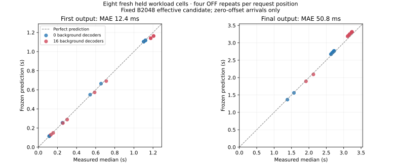

# Native effective endpoint pilot: measured audit and validation

The first native pilot passes its preregistered fixed-B2048, zero-offset endpoint gates. The uploaded raw archive independently reproduces the stored verdict on its exact source. This establishes a measured effective prediction candidate in this scope; physical-stage, complete-experiment, adaptive-cap and MPC acceptance remain false.

## Evidence identity

- Captured commit: `dc9847e33d93541071a0bbc4ea38e4fff4623131`.
- Archive: `1793040895234680956.tar.gz`, 7,988,044 bytes, SHA256 `c77b76ff3ce8aa09781c7538d81f7f9a38c04affe62998fc0a4d498751e47f58`.
- All 158 extracted files match the uploaded archive byte-for-byte. `input-files.json` retains their sizes and hashes.
- All 142 captured source files match the exact Git commit and its complete declared source inventory.
- Original native JUnit is included and independently validates **1042 passing CPU tests**, no failures/errors/skips, including all five required trace configurations. This is original JUnit evidence, not merely an embedded count.
- All138 trials complete once, no failures, active elapsed 534.591s. 62 OFF and 76 LIGHT trials; 1416 request instances.
- 15,047 observed executed LIGHT steps pass native work/dispatcher audits. Modes: NONE 704, FULL 14,317, PIECEWISE 26. All76 LIGHT own-work signatures, including warmups, match frozen independent rollout. Mode observations do not qualify exclusive GPU/stream costs.
- Host: RTX4090, Python3.12.3, vLLM0.30.0, Torch2.13.0+cu130, BF16, same-process V2 UniProcExecutor, two async slots; B2048, seq32, context8192, KV5594 blocks x16. CPU quota10.2 cores, affinity96, memory limit30,999,998,464 bytes. Runtime and38 installed source pins are stable within collection.

## Fresh held accuracy, separate from training-cell references

The six training cells use24 OFF trials. The eight fresh held workload cells use32 OFF trials and cover20 foreground request positions, each scored by its median over four repeats. Twelve later OFF/LIGHT training-cell reference trials are drift checks and are reported separately. Request positions in a batch and repeated trials are not assumed statistically independent. This is controlled deterministic exact-token traffic with forced outputs, not an Azure-trace or HTTP replay.

| Endpoint | Fresh-held MAE | Largest absolute error | Largest relative error | Equal-case-weight MAE |
|---|---:|---:|---:|---:|
| First output / TTFT | 12.367 ms | 42.911 ms | 4.341% | 9.850 ms |
| Forced final output | 50.784 ms | 77.105 ms | 2.428% | 39.934 ms |

MAE above weights each request position equally. The last column weights each of the eight workload cases equally. The largest absolute and relative errors need not occur on the same request. These are median endpoint results, not p99 or a guarantee for individual requests.



The largest fresh TTFT absolute error is mixed-D16 foreground-3: measured1206.321ms, predicted1163.410ms, underpredicted42.911ms. All20 fresh positions satisfy the original per-endpoint max(5ms,20%) TTFT and max(10ms,20%) completion rules. No threshold was changed after collection.

| Background decoders | Fresh TTFT MAE | Signed TTFT bias (prediction minus observation) |
|---|---:|---:|
| 0 | 2.990 ms | 1.551 ms |
| 16 | 21.744 ms | -21.744 ms |

**D16 systematically underpredicts first-output latency in every fresh held request position.** Passing the feasibility gate does not erase this bias. Do not tune the four laws on these held cells and reuse them as confirmation; future model changes need fresh calibration/validation. A future cap requires a separately justified uncertainty/safety treatment, not direct use of the mean prediction or the observed42.9ms maximum as a universal margin.

The separate12 training-cell reference positions have TTFT MAE 13.010ms, maximum 34.649ms / 4.401%; completion MAE 62.250ms, maximum 89.964ms. They are not eight additional independent held workloads.

## Parameter stability and observation quality

The frozen local sensitivity matrix has rank4 and normalized condition 4.100803. The original fitter requires both fixed starts to converge and agree. The archive retains its selected fit/diagnostics, not individual optimizer histories; the offline audit verifies training hashes and forecasts rather than replaying the original optimizer starts. Four additional post-run leave-one-training-block-out fits use only training labels, never held labels. All four converge and pass their local gates; no diagnostic fit replaces the original freeze. These are sensitivity diagnostics, not statistical confidence intervals or proof of global identification.

| Effective normalized coefficient | Frozen value | Leave-one-block-out full range / original |
|---|---:|---:|
| bias | 9.346854 ms | 0.101% |
| prefill/2048 | 100.603888 ms | 0.946% |
| decode_context/32768 | 7.331456 ms | 0.287% |
| attention_pairs/2097152 | 8.729938 ms | 3.115% |

These coefficients collapse CPU/GPU execution, submission, sampling, copy and commit into an effective service lane. They are not measured exclusive GPU forward costs. The21-component physical estimator remains unqualified.

All matched OFF/LIGHT and repeat-spread pilot gates pass. Training maximum TTFT pair difference6.155ms and OFF repeat spread7.495ms; held maxima11.242ms and11.053ms. Completion maxima: training5.939ms /6.481ms, held9.125ms /5.879ms. OFF retains private-control/scheduler-inspection overhead; the paired result measures incremental LIGHT overhead, not uninstrumented production overhead. Four repeats do not establish tail behavior, stationarity or independence.

## Reproduce and scope

```bash
python scripts/analyze_prefill_effective_capture.py --capture /path/to/1793040895234680956 --archive /path/to/1793040895234680956.tar.gz --output /tmp/new-effective-audit
```

The read-only analyzer verifies every archive member and reconstructs the exact142 source files from the fixed reviewed Git commit into a temporary tree. It executes the ORIGINAL audit there, preserving all existing gates. It does not patch source identity or procfs checks. This avoids the expected failure of the old audit when run directly from a later checkout with new scripts/tests. Training diagnostic implementations must also still match the captured source. Original raw files, frozen hash and thresholds remain unchanged.

The initial local audit attempt lacked httpx; declared CPU dependencies were restored. The final original-source audit passes. Local numerical diagnostics use NumPy2.3.5/SciPy1.17.0; native collection used NumPy2.3.5/SciPy1.18.1. Native frozen coefficients are preserved, not overwritten by local fits.

## Next engineering step

See `experiments/prefill-effective-arrivals-v2.proposal.md` and `arrival-proposal.json`. Eight prospective mixed-plus-sentinel cases at50/200/400/800ms with D0/D16 have own-rollout point forecasts within background-lifetime scope. They are DEVELOPMENT forecasts, not new native evidence. Delayed arrivals create a fifth foreground request and a new joint state; marginal prompt bounds do not qualify that composition.

The next collector must distinguish target, queue-post and engine-enqueue clocks, freeze before scored delayed observations and recalibrate on a new host. The proposal is design-only and not launchable yet. No new rental is requested by this analysis. HTTP/state observation and fixed-versus-adaptive cap testing follow delayed-arrival qualification; MPC remains downstream.

Validation scope and local test results are recorded in `validation.json`. No GPU was run by this read-only analysis. All full-model/control acceptance flags remain false.
