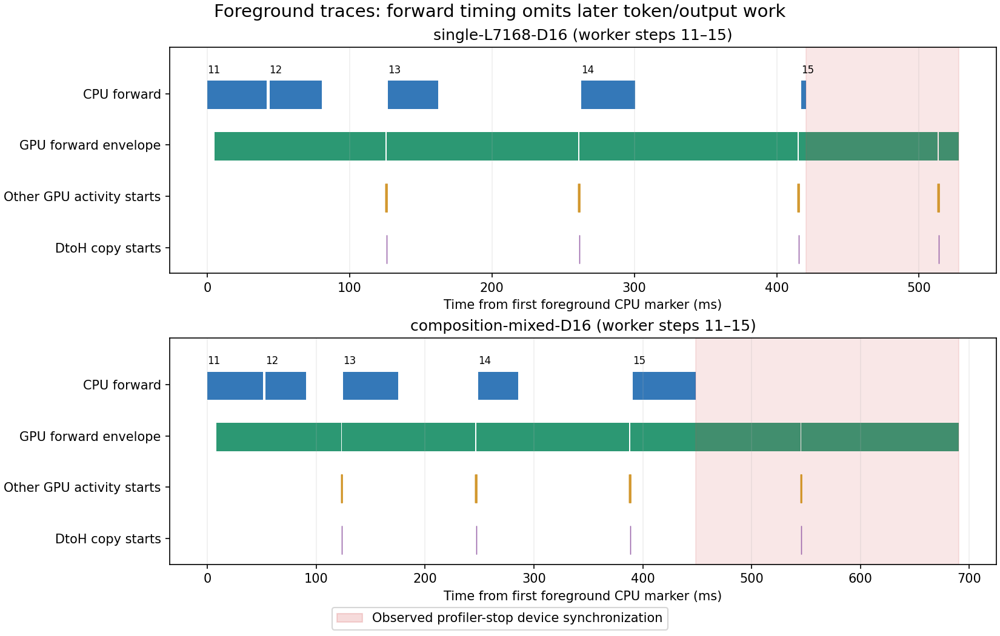

# Native foreground diagnostic: capture window passed, full service scope remains open

The corrected recorder captures foreground work in both deep cases. Independent
offline checks reproduce all four saved native work/dispatcher audits and both
foreground-window audits. CUDA launch correlations show token/output work outside
the forward hook. Keep GPU/model acceptance false and the serial overlap guard
unchanged. This is a successful targeted diagnostic, not a new complete suite or
an adaptive-cap/MPC result.



Blue spans are CPU forward ranges; green spans are the envelope of GPU activities
joined to those ranges by CUDA launch correlation, including idle gaps. Orange
and purple ticks show starts of activity launched outside those ranges, not
activity duration. Red shading is the observed device synchronization during
profiler stop. The two panels use their own first-marker origin and horizontal
scale. These traces are diagnostic, not performance-scored labels.

## Evidence identity

- Input: `pr32-diagnostic.tar.gz`, capture `1792901749676650134`.
- Archive size:3,711,060 bytes; SHA256
  `f2e5b40aa8a6547525893079290b6c90dc04db65c68c7a7be24a160d01af2d6c`.
- All28 regular files have bytes/SHA256 in [input-files.json](input-files.json).
  Raw files/flags were not modified. The uploaded archive is retained separately.
- Captured source commit:`6edb3e3f2e323c09a67e32afd7eddc97e799906e`.
  All125 declared source hashes match that Git commit, launch and native acceptance.
- Engine and worker35-file installed source maps match the captured reviewed map.
  Model/tokenizer commit:`cdbee75f17c01a7cc42f958dc650907174af0554`.
  The212-trial token manifest and retained Azure trace input identity also match.
- Initial/final runtime identities match. Recorded native CPU acceptance is
  valid, tracked-clean and876 tests with all five trace configurations. The
  original native JUnit is not in this archive;876 is the embedded acceptance
  record, not a rerun here.

The new machine has an RTX4090, driver595.91.07, Python3.12.3,
vLLM0.30.0/Torch2.13.0+cu130. Its CPU quota is15.3 CPUs, affinity128 CPUs,
memory limit142,999,998,464 bytes and GPU KV allocation5594 blocks. The prior
b04477e host had different resource limits/KV allocation. These captures are not
a paired before/after performance comparison. The observed V2 AsyncScheduler
still has two concurrent batches, batch budget2048, context8192 and graphs/async
enabled with prefix caching disabled.

## Independently recomputed checks

| Trial | Case | Mode | Native work/dispatcher | Foreground window |
|---|---|---|---|---|
| trial-014 | single-L7168-D16 | light warmup | passed,264 steps | not profiled |
| trial-007 | composition-mixed-D16 | light warmup | passed,264 steps | not profiled |
| trial-211 | single-L7168-D16 | deep | passed,264 steps | steps11–15, exact IDs/hash/markers |
| trial-212 | composition-mixed-D16 | deep | passed,264 steps | steps11–15, exact IDs/hash/markers |

The planned/completed order matches the frozen two matching warmups plus two deep
cases. Diagnostic completion is true, elapsed23.937647s, failures empty. Recomputed
audit objects equal the saved objects exactly. Both cases retain overlapping
async wall labels. No gateway, Azure transfer, model fitting or held scoring runs
in this scope. A real Azure dataset is an input here, not evidence that Azure
traffic was replayed during this diagnostic.

## GPU activity and forward boundary

The audit joins every captured kernel/memcpy/memset to its CUDA runtime/driver
launch correlation and then to a same-process, same-thread CPU marker. GPU
execution can occur after that CPU marker ends. Graph nodes share their graph
launch correlation. Assignment does not use nearest timestamps, CPU/GPU overlap
or numeric equality of CUDA stream handles and CUPTI stream IDs.

| Quantity | single-L7168-D16 | composition-mixed-D16 |
|---|---:|---:|
| Total captured GPU activities | 2283 | 2112 |
| GPU activities without launch correlation | 0 | 0 |
| All captured kernels | 2074 | 1899 |
| Forward modes, five calls | NONE,NONE,NONE,NONE,FULL | NONE,NONE,NONE,NONE,NONE |
| Kernels launched outside forward ranges | 40 | 40 |
| Memsets launched outside forward ranges | 4 | 4 |
| Memcpys launched outside forward ranges | 8 | 8 |
| Forward activity CUPTI stream | 7 | 7 |
| Outside-forward CUPTI streams | 7,13 | 7,13 |
| Profiler-stop device synchronization | 107.195ms | 241.578ms |

Outside-forward activity includes a logits GEMM, `_gumbel_sample_kernel`, argmax,
`_get_num_sampled_and_rejected_kernel`, `_post_update_kernel` and DtoH copies.
The trace supplies names, correlations and placement. The stage interpretation
also follows the reviewed v0.30.0 V2 source: `execute_model` stores hidden states;
`sample_tokens` calls `sample`, which computes logits and samples; it constructs
AsyncOutput before `postprocess_sampled` updates GPU state. Thus DtoH and state
update must not be modeled as an invented strictly serial dependency.

Relevant source:
[model_runner.py at v0.30.0](https://github.com/vllm-project/vllm/blob/v0.30.0/vllm/v1/worker/gpu/model_runner.py).
This source-level interpretation does not make individual unnamed runtime calls
or all unprofiled engine work qualified.

There are four token/output gaps per trace because the recorder stops after the
fifth **forward** call. Fifth-call sampling/copy/update occurs after profiler stop
and is not captured. The existing marker gate deliberately establishes the
forward window only. Deep profiler stop synchronizes and exports on the worker
path; do not use these deep TTFT/wall labels as ordinary light-run latency or
infer their overhead from one unpaired warmup/deep pair.

Nine NONE calls and one FULL graph replay provide useful narrow evidence. They
do not cover PIECEWISE or all modes/padding/streams. GPU annotations alone also
do not include every correlated activity: each NONE call has seven correlated
activities extending outside its GPU annotation, while the FULL call has zero.
The audit uses the launch join for envelopes rather than treating those GPU
annotations as complete coverage.

Forward event elapsed values broadly track the correlated GPU envelopes in
these calls, but they include input preparation/device idle gaps, have no CUPTI
endpoint timestamps in the artifact and exclude later token/output work. No
predefined equivalence tolerance, complete stream qualification or pure-compute
label is established by their numerical closeness.

## Consequence for the model and cap

The next model needs separate CPU submission, GPU forward, token/output, copy
and commit stages with native resource/event dependencies and two batch slots.
First token is visible at output commit, not at forward return. Use maximum of
dependency/resource-ready times to propagate stage completion, rather than
summing overlapping schedule-to-output durations.

The concrete proposed state, measurements, calibration split and validation
boundaries are in
[the async pipeline proposal](../../experiments/prefill-async-pipeline-v1.md).
That document is a design proposal. The existing serial predictor is not
replaced, no stage coefficients are fitted and no new GPU collector hooks are
implemented in this change. These two development traces must not be used to
select M0/M1/M0Z/M2 or tune a new held acceptance threshold. Fresh confirmatory
data requires a reviewed/frozen new protocol after stage instrumentation.

Do not rerun the full20-minute suite merely to remove the overlap failure. Next
engineering work is to collect complete step-bound sampling/copy/update/commit
labels and implement a causal async rollout. Then qualify prediction before
comparing fixed cap, state-dependent cap and eventually MPC. Admission cap,
vLLM batch token budget and output-token limit are different controls.

## Reproduce and validation scope

From a checkout containing the captured commit and the extracted archive:

```bash
python scripts/analyze_prefill_diagnostic.py \
  --capture /path/to/1792901749676650134 \
  --archive /path/to/pr32-diagnostic.tar.gz \
  --output /path/to/fresh-analysis --plot
```

The script only reads capture/source files; it refuses an existing output path.
[analysis.json](analysis.json) records exact correlation results, stage timelines,
source identities and scope flags. [validation.json](validation.json) and
[related-tests-junit.xml](related-tests-junit.xml) record110 passing local related
CPU tests with zero failures/errors/skips, including11 new graph-correlation,
marker-identity, ambiguous-launch, thread-boundary and interval-union cases.
An initial local attempt had19 passes/two import failures because httpx was absent;
installing the declared CPU dependencies resolved those environment failures.
The final110-test run is separate from the captured native876-test record.

This offline analysis performed no GPU execution. `cuda_scope_qualified`,
`gpu_validated`, `model_accepted` and complete-experiment acceptance remain false.
