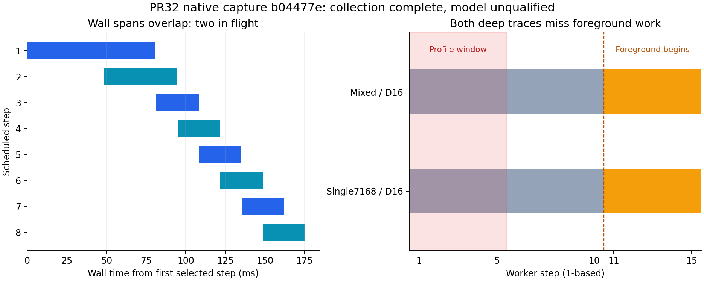

# Native capture audit: completed collection, unresolved async model

Capture: `1792824425926915196`, source commit `b04477e8e06af31ee390b749b61fba60ef480ecb`.
Archive SHA256: `13b67986325a0c3e24460aae5ba5d5a30515bd891342c529e55b5cb6b510b0d5`.
The uploaded immutable archive remains the evidence source. `input-files.json`
records every extracted file's bytes/SHA256; the raw archive is not duplicated in
this repository. No raw capture or prior acceptance file was rewritten.

The complete collection took1210.459s (20m10.459s). All212 trials and four frozen
Azure attempts are present. Independent offline work/dispatcher/offer checks pass.
The recorded native CPU acceptance says865 passed, valid and tracked-clean;
its121 source fingerprints match that git commit and the collection/launch
identities. Installed vLLM35-file source pins and initial/final runtime identities
match. The original JUnit file is outside this archive, so the865-test statement
is the embedded native acceptance record, not another local full-suite rerun.

| Stage | Completed/planned | Recorded status |
|---|---:|---|
| Warmup |22/22|complete_valid|
| Observer |60/60|complete_valid|
| Main |110/110|complete_valid|
| Drift reference |10/10|complete_valid|
| HTTP bridge |8/8|complete_valid|
| Azure transfer |4/4|complete_valid|
| Deep diagnostic |2/2|work collection complete; foreground profile coverage fails below|

## Why calibration is inconclusive

The observed backend is V2/AsyncScheduler, async scheduling enabled and two batches
in flight. Every one of the18 calibration trials has two overlapping selected
wall spans. Summed durations are1.9369–1.9759 times their interval union. This is a
comparison of CPU-side schedule-to-output intervals, **not** a GPU-utilization
estimate, GPU overlap measurement or physical cost coefficient.

The model freeze correctly raises `Overlapping wall labels cannot support serial
cumulative selection` before fitting/selecting M0/M1/M2 or evaluating readiness.
No model wins or loses this run. Existing held data has not selected a new model.
Removing the check, clipping overlap, switching to completion gaps or summing
unqualified GPU events would change label semantics and would not validate the
serial predictor of sentinel TTFT. Block dependence also remains unresolved.



## Additional collector defect: profiler stops before foreground

At the captured source revision, the deep profiler starts at worker_begin and
stops after the first five execute_model calls. Both deep cases have sixteen
backgrounds; the first foreground-bearing call is worker step11. The first five
calls contain only background work and use runtime NONE with2048 scheduled tokens.
Both exported traces contain21673 events/1905 GPU kernels and no stable step-ID
markers. Neither profile covers the target single7168 or mixed foreground window.

| Case | First foreground worker step | Foreground steps in legacy five-call window |
|---|---:|---:|
| single-L7168-D16 |11|0|
| composition-mixed-D16 |11|0|

The traces show kernels on Kineto stream7 and copies on streams7/13. Kineto IDs
are not the CUDA stream handles recorded by the worker; numeric differences are
not proof of an incorrect stream. The limited coverage and missing per-step
markers prevent a full forward/sampling/stream qualification. The raw CUDA-event
scope stays unqualified. A serial GPU-forward cost would still need an explicit
async pipeline/host-overhead model to predict end-to-end TTFT.

## Other measured results

| Frozen transfer | Complete |503 rejected|Max offer lag(ms)|Peak sampled runner RSS(MiB)|
|---|---:|---:|---:|---:|
|A-r1|411|1557|7.763|172.89|
|B-r1|403|1683|7.045|176.48|
|B-r2|421|1665|6.213|176.38|
|A-r2|414|1554|7.470|172.80|

All8108 offers reconcile:1649 complete,6459 rejected, no failed HTTP rows. Native
request/worker checks and the persisted bounded-GC audits pass. The50ms offer-lag
threshold is unchanged. Rejection is expected under fixed-cost32 admission and
does not itself establish a useful SLO/controller outcome. All five drift checks
stay below their10% flag. The four observer engineering-overhead bounds pass;
the largest upper fraction is0.1974%, not a claim of zero observer effect.

## Corrective implementation and next evidence

Deep profiling now waits for the first controlled foreground/sentinel call, then
records five consecutive worker calls with `prefill_lab_step/<step_id>` CPU ranges.
Each artifact has a returned SHA256 and exact step-ID list. The profile audit
checks first-foreground alignment, the five-call window, artifact identity, exact
CPU markers and GPU-kernel presence. It qualifies the **profile window only**;
`cuda_scope_qualified`, `gpu_validated` and `model_accepted` stay false.

`prefill_host.py diagnose` runs the two matching frozen light warmups and two deep
trials on one loaded engine, under the existing exact-revision native acceptance
gate. It writes a separate `~/pr32-diagnostics/<id>/diagnostic.json` and180s bounded
diagnostic, never a complete suite or new model freeze. Existing complete-suite
runs now also require profile-window integrity for deep stages. Old evidence is
preserved with its original source identity and scope.

The immediate next step is to collect those two corrected foreground profiles.
Then map step markers to GPU activity, verify graph/stream and sampling boundaries,
and specify an async-compatible timing/rollout model using calibration-only
information. Do not rerun the full suite simply to remove the overlap gate.

## Reproduction

```bash
python scripts/analyze_prefill_capture.py --capture CAPTURE --output NEW_AUDIT_DIR --archive ARCHIVE
python scripts/plot_prefill_capture_audit.py --capture CAPTURE --output NEW_AUDIT_DIR
```

The source commit's git objects must exist locally. The analyzer reads its frozen
order/cases and verifies those source fingerprints; outputs go to a fresh folder.
The offline audit is descriptive/integrity analysis and never fits a replacement
model, changes archived flags or claims GPU/model acceptance.

## Validation of the corrective code

All212 related CPU tests pass without skips, including10 new foreground-profile,
targeted orchestration and interval-union cases and one new host diagnostic gate
case. The older suite-order/freeze-failure tests explicitly mock the new profile
audit because they mock every capture; actual recorder/artifact failure paths have
separate coverage. Source/design hashes, compilation and whitespace checks pass.
See validation.json and related-tests-junit.xml. The new profiler/diagnostic path
has not run on a GPU here; its exact-revision native acceptance and targeted
foreground traces remain the next required evidence.
