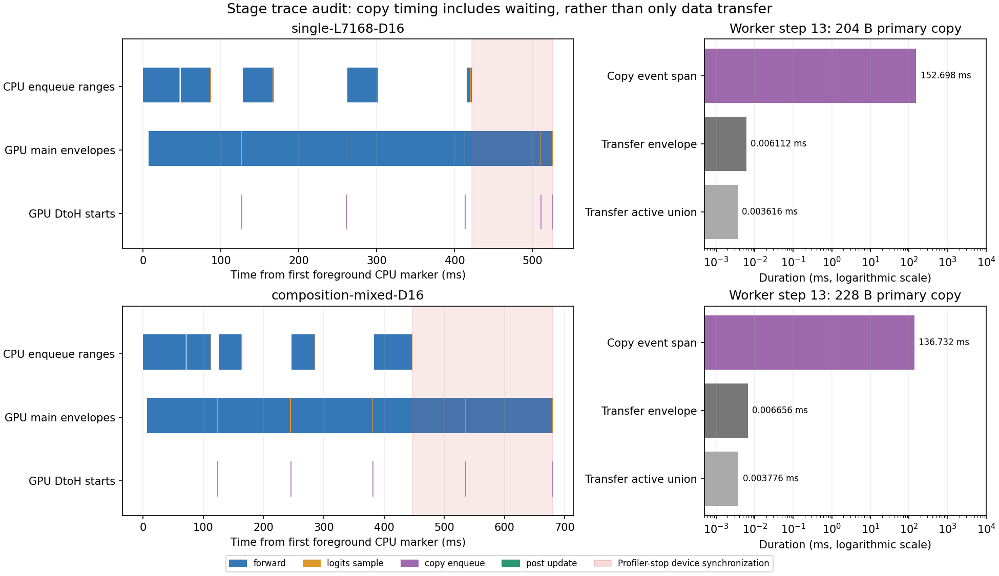

# Native stage diagnostic: complete token/output window and wait-inclusive copy timing

The ab24416 native stage diagnostic passed independent source, work, dispatcher,
pipeline and foreground-profile checks. Four trials contain1056 steps,7392 CPU
stage spans and5280 stream-local CUDA spans. Both deep traces include the fifth
sampling/copy/update tail; all4421 captured GPU activities join to non-nested
forward, logits/sample, copy or post-update CPU launch ranges.

This establishes that the new stage hooks execute and preserve scoped accounting
on this native host. It does not fit a predictor, qualify every CUDA timing label,
accept a physical model or evaluate cap/MPC. Original acceptance flags and raw
files remain unchanged.



Left panels use the trace's common CPU/GPU clock. Main-stream bars are envelopes
of launch-correlated GPU activities, not pure active-compute durations. Copy ticks
show transfer starts; red shading is profiler-stop device synchronization. The
right panels compare three different duration scopes for worker step13, on a
logarithmic axis. Event start/end GPU timestamps are not present in these traces,
so no synthetic absolute event interval is drawn. All ten profiled calls, not
only the illustrated third call, are retained in [analysis.json](analysis.json).

## Source and input identity

- Capture:`1792991194546315502`; input:`pr32-stage-diagnostic.tar.gz`.
- Archive bytes:3,956,779; SHA256
  `a5a446a27f0a991f8ee715ee4f0010ab32a5c9cdc3e3188ec97e54525c10571e`.
- All29 regular input files have bytes/SHA256 in [input-files.json](input-files.json).
  The original uploaded archive is retained separately; raw files are not edited.
- All130 captured source fingerprints match Git commit
  `ab24416334174f31c0c8b686ff4d0e496f86a969`, launch and native acceptance.
- The embedded native acceptance records927 tests, valid/clean and all five
  trace configurations. Its original JUnit is not in the archive;927 is the
  recorded acceptance outcome, not a full-suite rerun in this workspace.
- All38 installed vLLM engine/worker source pins match the captured reviewed map.
  Model/tokenizer commit is `cdbee75f17c01a7cc42f958dc650907174af0554`.
  Token-manifest, retained Azure input identity, development stage protocol and
  initial/final runtime identities also match.

The captured runtime is V2 GPUModelRunner in the same process as UniProcExecutor/
EngineCore (PID7782), AsyncScheduler with two concurrent batches, TP/PP/DP1,
B2048, context8192, seq32, bf16, graphs/async enabled and prefix cache disabled.
The RTX4090 host has driver595.91.07, Torch2.13.0+cu130/vLLM0.30.0,
Python3.12.3,17.85CPU quota/128CPU affinity,82,999,996,416-byte memory limit and
5594 GPU KV blocks. This is a different physical host/resource allocation from
the previous captures, so cross-host numbers are not paired performance tests.

## Recomputed native integrity

| Trial | Case | Observer | Work/dispatcher/pipeline | Profile window |
|---|---|---|---|---|
| trial-014 | single-L7168-D16 | light warmup | passed,264 steps | not profiled |
| trial-007 | composition-mixed-D16 | light warmup | passed,264 steps | not profiled |
| trial-211 | single-L7168-D16 | deep | passed,264 steps | worker steps11–15, complete fifth sampling tail |
| trial-212 | composition-mixed-D16 | deep | passed,264 steps | worker steps11–15, complete fifth sampling tail |

All four recomputed audit objects equal the persisted objects, including token
totals/first-output times, stage/forward/request identities, stream/thread/order,
finite timing, event resolution and the exact profile artifact hashes/markers.
The stage protocol's planned/completed order matches exactly. Diagnostic complete
is true, elapsed25.431896s, failures empty. Initial/final runtime identities match.

There are62 NONE and994 FULL worker calls across all four trials. The deep sample
contains nine NONE calls and one FULL call; it has no PIECEWISE example. Seven
CPU stages and five CUDA pairs are retained per step. Optional extra copy payloads
are absent in all1056 steps. This mode runs no gateway/Azure offers,18-trial model
calibration or held scoring. The212-trial token manifest is prepared input, not
212 experiments executed in this diagnostic.

## Complete fifth-call GPU attribution

Each GPU kernel/memcpy/memset is joined by its runtime/driver launch correlation
to one same-process/same-thread non-nested CPU stage. Parent sample_tokens is
excluded from leaf ownership. Missing/ambiguous launches or overlapping leaf
ownership fail analysis; GPU timestamp proximity is never used to guess an owner.

| Trace quantity | single-L7168-D16 | composition-mixed-D16 |
|---|---:|---:|
| Total GPU activities / unmatched | 2296 /0 | 2125 /0 |
| Forward kernels | 2034 | 1859 |
| Forward memsets / HtoD copies | 180 /17 | 180 /21 |
| Logits/sample kernels / memsets | 45 /5 | 45 /5 |
| DtoH copies | 10 | 10 |
| Post-update kernels | 5 | 5 |

The ten copies per trace are two primary-buffer transfers for each of five calls.
Each call includes nine logits/sample kernels, one sampling memset and one
post-update kernel. Thus the missing fifth sampling tail in the earlier6edb3e3
capture is resolved in this ab24416 capture.

Observed forward/logits/update launches use CUPTI stream7; copy launches use13.
These identities follow launch correlations; they are not inferred by comparing
numeric CUDA stream handles to CUPTI stream IDs. In six of ten profiled calls,
the union of the two transfer activities overlaps the post-update kernel by
about1.056–1.792us. The graph must permit this branch overlap, as prescribed by
the native AsyncOutput-before-postprocess source order. This is observed narrow
window behavior, not an all-workloads stream-coverage qualification.

## Copy time is mostly a dependency wait in this timer scope

The existing stage protocol deliberately records the copy start event **before**
the native copy stream waits on the main stream. The end event follows native
copy enqueue. Elapsed time therefore includes pending dependency work and event/
enqueue effects, not just the transfers. CPU copy enqueue may happen after some
forward execution has already progressed, so its wait need not equal the entire
forward duration; see the first profiled call of each case.

Across the ten calls, copy event spans are15.140–154.043ms, while the two DtoH
activities occupy3.648–7.072us envelopes and2.336–4.095us active unions. These
small-buffer observations do not establish general transfer bandwidth or the
cost of optional payloads. The illustrative third call has:

| Worker step13 | Single | Mixed |
|---|---:|---:|
| Primary copy bytes | 204B | 228B |
| Wait-inclusive copy CUDA event | 152.697540ms | 136.732422ms |
| Correlated transfer envelope | 0.006112ms | 0.006656ms |
| Transfer active union | 0.003616ms | 0.003776ms |

A predictor that first waits for logits readiness, then adds the raw copy event
as its copy-service duration, charges the same dependency twice. Likewise,
sample_tokens is a parent span containing logits/sample and post-update; adding
that parent and its children double counts nested work. Do not replace an event
with a transfer-envelope number and claim calibrated service costs: only ten
development calls have this profiler attribution, one case is a held composition,
and event GPU endpoints/normal-observer overhead remain unqualified.

## Timing and remaining limits

Deep profiler stop/export takes329.425ms in the single case and480.393ms in the
mixed case. Stop itself accounts for257.759/401.835ms and export for71.665/78.558ms.
Deep TTFT/wall observations are diagnostic, not ordinary service labels.

The two light warmups have median logits/sample event spans0.916/0.968ms and
sample_tokens spans0.929/0.981ms. Deep trials have isolated logits/sample maxima
15.240ms at worker step82 and19.961ms at step54, outside the profiled11–15 window.
The archive does not establish their cause. In particular, there is no native GC
span evidence for those events, and they must not be attributed to GC or profiler
stop from timestamp proximity alone. Do not trim them or silently turn event
elapsed times into pure GPU-compute costs.

This diagnostic has no OFF/light overhead pairs, no six-cell calibration repeats,
no block-dependence qualification and no independent held model validation. Its
two warmup/deep pairs are not a noise or observer-overhead study. Native scope
flags remain `cuda_scope_qualified=false`, `gpu_validated=false`,
`model_accepted=false`, `complete_experiment_passed=false`.

## Next implementation milestone

Stage collection is now demonstrated on the native host. The next CPU work is
the predictive event/resource graph and the native two-slot scheduler/placeholder
state transition, with costs supplied by a separately frozen calibration process.
Keep CPU submission, main-stream forward/logits/update, copy readiness/transfer
and output commit separate. Copy and post-update depend on sampling and may
overlap; neither is automatically a serial prerequisite of the other. Engine
TTFT ends at first output commit; HTTP/gateway TTFT needs additional qualification.

The next calibration/validation protocol must specify eligible label scopes,
uncertainty, training-only model selection and fresh whole-case/repeat tests
before collection. These development profiles cannot select M0/M1/M0Z/M2 or tune
new acceptance thresholds. The old serial overlap guard remains correct and
unchanged. No new full-suite rerun or GPU hook change is introduced by this audit.
Do not compare cap policies until prediction is qualified; no adaptive-cap/MPC
benefit follows from successful stage collection.

## Reproduce and local validation

```bash
python scripts/analyze_prefill_diagnostic.py \
  --capture /path/to/1792991194546315502 \
  --archive /path/to/pr32-stage-diagnostic.tar.gz \
  --output /path/to/fresh-analysis --plot
```

[analysis.json](analysis.json) contains all per-trial statistics, per-call leaf
activity scopes, copy/update overlaps and original source identities. The analyzer
never changes raw measurements, fits a model or promotes acceptance flags.
[validation.json](validation.json) and [related-tests-junit.xml](related-tests-junit.xml)
record224 passing local related CPU tests, zero failures/errors/skips, including
ten new leaf-attribution tests for parent double counting, stream domains,
overlap and missing/ambiguous identities. These selected local tests are separate
from the embedded927-test native acceptance. This workspace performed no GPU
execution; its initial test command could not start until declared pytest/CPU
dependencies were installed. Compilation, source fingerprints, archive replay and
staged whitespace checks pass. The generated scientific figure was inspected.
