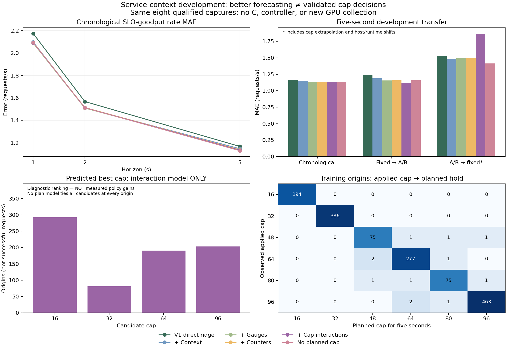

# Service context improves forecasting slightly; cap decisions remain unvalidated

The same eight qualified full captures were freshly audited, and all 2,400
one-second origins received verified cost/token context and causal counter-rate
features. Original raw data, failed captures, thresholds and suite status remain
unchanged. No new GPU experiment, MPC controller or C evaluation was performed.

## Forecast results

Chronological cohort SLO-goodput **rate MAE**, requests/s; smaller is better:

| Model | 1 s | 2 s | 5 s |
|---|---:|---:|---:|
| PR #26 direct ridge | 2.174 | 1.568 | 1.1684 |
| + Cost/token/age context | 2.098 | 1.511 | 1.1484 |
| + Engine gauges | **2.088** | **1.510** | 1.1395 |
| + Counter rates | 2.094 | 1.515 | 1.1392 |
| + Cap interactions | 2.092 | 1.513 | 1.1354 |
| No planned-cap inputs | 2.092 | 1.512 | **1.1304** |

The context/gauge/counter model improves five-second MAE by about **2.50%** over
the direct baseline. Counter rates alone add only about **0.03%** over the matched
gauge model, and worsen one/two-second scores. Their incremental benefit is not
established. Counter features do not automatically solve the prediction problem.

No-plan is the matched counter model with the three planned first/mean/end-cap
inputs removed. It retains the observed applied cap, backlog and history. Its
similar/slightly better score means the new planned-control inputs have not shown
reliable incremental predictive value in these development captures. This does
**not** mean real cap changes have no effect: existing state already reflects
previous cap choices, and most scored origins contain no actual switch.

Five-second transfer MAE:

| Training → evaluation | V1 direct | Context | Gauges | Counters | Cap interactions | No plan |
|---|---:|---:|---:|---:|---:|---:|
| Fixed → A/B | 1.241 | 1.191 | 1.158 | 1.160 | **1.115** | 1.159 |
| A/B → fixed | 1.529 | 1.485 | 1.499 | 1.496 | 1.865 | **1.416** |

The second direction includes 888 origins outside the 48–96 training-cap range,
plus host/runtime shifts. The interaction model's failure there argues against
promoting its favorable first-direction result. Near cap changes, chronological
five-second rate MAE is 1.400 for V1, 1.332 for counters and 1.257 without planned
cap, over only 90 overlapping origins. No statistical significance or acceptance
pass is claimed. All 576 groups, all targets, tails, optimism, per-run errors and
leave-one-run-out results are preserved in [metrics.csv](metrics.csv).

## What the cap-response check can and cannot say

For 768 chronological five-second origins, candidate held caps 16/32/64/96 are
evaluated using the same origin features. These are predicted counterfactuals,
**not observed policy outcomes**. The linear direct/counter models prefer 16 at
all origins, while the interaction model predicts best caps 16/32/64/96 at
293/81/191/203 origins. No-plan ties every candidate at every origin.

A linear model's endpoint preference is structural, not a proof that cap16 is
best or that the model is wrong: fixed-run cap32 results come from different
state histories. Likewise, varied rankings after adding quadratic terms do not
validate a controller. The candidate-outcome differences cannot be checked from
these fixed-run observations alone.

The important data gap is concrete: **there are zero 16↔32 switches in any of the
eight captures.** In the purged five-second training rows, applied16/planned16 has
194 origins and applied32/planned32 has 386, but both cross directions have zero.
Many higher-cap off-diagonal cells have only one/two origins at the target-time
boundary before actual application. Overlapping rows are not independent switch
replicates. Training-support counts and distances are descriptive, not guarantees.

## What to do next

The project can continue designing an MPC optimizer, but these results do not
establish a model that can reliably rank its low-cap actions. Direct multi-horizon
forecasts also are not a physically consistent trajectory simulator. Optimizing
their predictions could exploit unsupported state/action combinations.

Before claiming closed-loop MPC benefit, prepare targeted **low-cap switching
identification**, rather than another large fixed-cap sweep or more blind feature
search. A candidate design would exercise 16↔32 and modest changes around 32
(for example 32↔48), at different arrival phases on one host, with fixed32 repeat
references and separate development/validation captures. Hold duration, ordering,
repeats and gates must be declared before collection; this paragraph does not
freeze or authorize a rental. Final C remains reserved for a frozen evaluation.

## Artifacts and validation

- [Method/settings](../../experiments/service-forecast-v2.md) and
  [fixed development inventory](../../experiments/service-forecast-v2.json).
- [Summary](summary.json): aggregate/per-run errors, ranking counts, source table
  fingerprints and training transition coverage.
- [Full report](full-report.json.gz): all fitted coefficients/preprocessing,
  metrics, chronological predictions, and cap-response/support diagnostics.
- [Verified derived tables](dataset.json.gz): exact 2,400 rows plus manifest,
  original raw/audit fingerprints and extraction-code hashes; no original logs
  are replaced. The raw archives remain in their existing repository locations.
- [Reproducer](reproduce.py): cached-table or fresh-raw mode, no GPU required.
- [Figure/summary generator](summarize.py).

Fresh original audits passed for all eight selected captures; original snapshot
and flow checks pass, and service costs reconcile at every origin. All **576**
direct-ridge baseline groups reproduce PR #26 numerically. Complete cached-score
reproduction also passes, including cap-response diagnostics. Figure rendering
and artifact/code fingerprints were checked. **230 relevant tests passed** across
seven modules, including counter causality/reset guards, future-data exclusion,
matched ablations, cap support, ties, cache corruption and output preservation.
Python 3.12.14 / NumPy 2.3.5.

The gauge-only comparator was added during self-review to isolate counter-rate
effects; no existing model/parameter was tuned. The original v1 artifact is kept
unchanged. These are already examined development data, all replaying the same
arrival window; holdout runs do not establish unseen-workload generalization.
There was no new full native CPU/mock acceptance run or live GPU validation.
