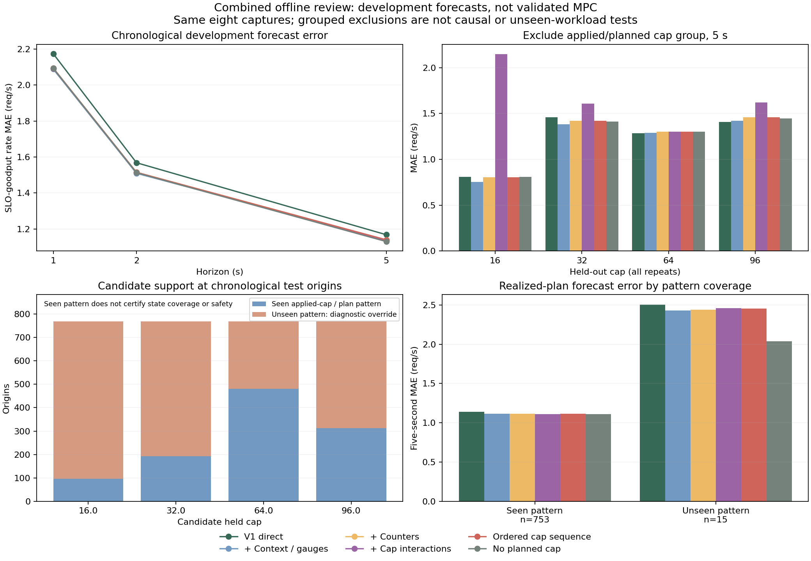

# Combined review: reliable offline forecasts before MPC

PR #26 now contains the v1 transition prototype, v2 service-context follow-up and
this review. PR #27 was merged into its branch. **No controller is enabled.** The
same eight qualified captures are used; no new GPU experiment or C evaluation
has occurred. The original [v1](../transition-prototype-20261020/report.md) and
[v2](../service-forecast-20261020/report.md) reports remain preserved.

## What the review changed

- Reject malformed, stale, slow or overlapping counter scrapes instead of treating
  their increments as trustworthy short-interval rates.
- Validate core state/context and missing flags at training/prediction boundaries.
  Distinguish legitimate negative headroom during drain from inconsistent state.
- Reject an unseen current-applied-cap/planned-sequence pattern by default, even
  within the numeric cap range. Explicit diagnostic overrides are separately
  recorded for extrapolation and unobserved patterns. Seen patterns do not imply
  causal coverage or safety.
- Add one fixed ordered-sequence encoding, because different future plans can
  share the same first/mean/last cap and cap-square summaries. Keep every prior
  model; no hyperparameter search or selection based on these results.
- Exclude all repeats of a fixed cap together, and filter that cap's current and
  within-horizon planned occurrences out of other training runs. Earlier workload
  history and host/runtime confounds remain. This is a tougher developmental
  check, not an independent causal or workload test.
- Preserve hash-verified historical scoring sources, fresh raw audits, derived
  tables, full per-run/target/tail results and repeatable score/coefficient checks.

The [method](../../experiments/service-forecast-reviewed-v3.md) and
[fixed settings](../../experiments/service-forecast-reviewed-v3.json) describe the
boundaries. A forecast of successful future arrivals is not an SLO constraint:
these direct heads do not enforce cross-horizon consistency or conservation.

## Findings

Five-second future-cohort SLO-goodput rate MAE, requests/s; lower is better:

| Evaluation | V1 direct | Context + gauges | + Counters | + Cap interactions | Ordered sequence | No planned cap |
|---|---:|---:|---:|---:|---:|---:|
| Purged chronological | 1.1684 | 1.1395 | 1.1392 | 1.1354 | 1.1399 | **1.1304** |
| Fixed → scheduled A/B | 1.2413 | 1.1576 | 1.1597 | **1.1150** | 1.1600 | 1.1589 |
| A/B → fixed | 1.5288 | 1.4986 | 1.4960 | 1.8651 | 1.4970 | **1.4156** |
| Exclude cap 16 group | 0.8083 | **0.7538** | 0.8046 | 2.1487 | 0.8043 | 0.8090 |
| Exclude cap 32 group | 1.4606 | **1.3819** | 1.4230 | 1.6102 | 1.4229 | 1.4140 |
| Exclude cap 64 group | **1.2831** | 1.2914 | 1.3017 | 1.3030 | 1.3019 | 1.3005 |
| Exclude cap 96 group | **1.4078** | 1.4202 | 1.4600 | 1.6192 | 1.4596 | 1.4489 |

The omitted context-only model scores 1.2641 on exclude-64; every model is retained
in the complete metrics. Group 16 and 96 tests extrapolate
outside their training cap range; group 32 and 64 tests are numerically inside
range but every held-out action pattern is unseen. A/B→fixed has 888 extrapolated
origins out of 1,776. Reused overlapping seconds are not independent observations;
these pooled errors are descriptive, not significance tests or acceptance limits.

The ordered encoding repairs plan aliasing, but does not establish better action
selection. Added counter inputs also do not consistently help grouped transfer.
The interaction model's chronological improvement does not survive several
holdouts; its exclude-16 error is 2.1487. We retain those failures rather than
retuning on the same tests. Removing planned controls still performs best in the
pooled chronological evaluation. That does **not** show real cap interventions
are ineffective: the fixed-cap measurements already show differences, while this
model lacks reliable evidence for choosing a new cap from a common origin state.

### Coverage explains why numerical interpolation is insufficient

Chronological realized-plan evaluation contains 753 seen-pattern origins and 15
unseen-pattern origins. Counter-model five-second rate MAE is 1.1132 versus
2.4423 respectively; the small, different subset is not a causal estimate of
unsupported-action harm.

Candidate diagnostics hold each of the 768 chronological origin states fixed:

| Candidate held cap | Unseen applied-cap/planned-sequence patterns | Seen patterns |
|---|---:|---:|
| 16 | 672 | 96 |
| 32 | 576 | 192 |
| 64 | 288 | 480 |
| 96 | 455 | 313 |

These are **model queries, not executed policies**. Many queries propose a switch
that has never been observed. Pattern membership alone ignores state distance,
input mix, host/runtime and hidden work. No 16↔32 switches exist in the captures.
The sequence/counter linear models predict cap16 at every origin; that endpoint
preference is not evidence that cap16 beats the measured cap32 baseline. The
no-plan ablation ties all four candidates at every origin.



## Validation and reproducibility

- All eight original raw-data audits, snapshot/state-flow checks and service-context
  reconciliation pass again. All 2,400 derived rows and their run/table hashes are
  identical to v2 after the stricter scrape guards; no selected origin loses a rate.
- All 576 legacy metric groups remain exactly identical. The historical v2
  reproducer independently reproduces its scores and 768 cap diagnostics using
  the verified code snapshot.
- The new report contains 1,440 score groups, seven fixed models, three horizons,
  seen/unseen-action subsets and four grouped exclusions. Full coefficients,
  predictions, per-target tail errors and source fingerprints are retained.
- Offline regression results, current-source fingerprints and both reproduction
  checks are recorded in [validation.json](validation.json).
- Native CPU acceptance did **not** run: the clean combined revision failed its
  PID/procfs namespace preflight with `procfs_pid_namespace_unverified`.
  [Original evidence](native-preflight-blocked.json) is retained. Offline tests
  are not a replacement for that acceptance gate, and the earlier 504-case GPU
  runtime acceptance is not evidence for this new model code.

```bash
python results/service-review-20261020/reproduce.py --output-dir /tmp/service-reviewed-repro
```

This verifies report, manifest, table and code hashes, refits the fixed models,
and compares scores, coefficients and action diagnostics to tolerance 1e-8.
It refuses existing output. Cached replay does not redo raw audits. Numerical
results are in [summary.json](summary.json), [metrics.csv](metrics.csv), and the
complete compressed [report](full-report.json.gz); audited tables are in
[dataset.json.gz](dataset.json.gz).

## Decision and stopping point

Subsequent [frozen-model diagnosis](../flow-diagnosis-20261020/report.md) identifies
unevolved endogenous histories and correlated component-flow errors in the v1
rollout. It prioritizes an origin-only augmented-state model test before
additional measurement. Missing 16↔32 observations are a validation gap, not an
established explanation of the existing model error. The review findings below
remain historical development results.

This PR is an offline modeling and evidence package. It is ready to review as
that scope, with native acceptance still outstanding. It is **not ready for a
validated live MPC comparison**. More iterations on the same captures cannot
supply unmeasured low-cap switching outcomes or independent workload validation.

Before freezing a live controller, the next experiment should identify 16↔32
transition response and repeatability on one host with matched arrival schedules,
plus a frozen model/decision validation plan. Keep cap32 as a measured candidate
baseline, compare against simple reactive control, account for drain delay and
collect objective goodput alongside latency misses/rejections. Do not use C as a
tuning loop or claim policy benefit from offline candidate predictions. Collection
settings, limits and duration remain to be designed; existing capture gates
remain unchanged.
