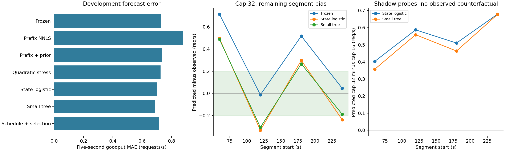

# State-aware development ablations on the 16/32 captures

Adding prefill/backlog information improves five-second goodput forecasts modestly,
but does **not** resolve cap selection. The cap-32 segment errors and the shadow
probes remain problematic. These results do not qualify a controller or justify a
policy-gain claim. This report supplements the [original frozen evaluation](../low-cap-frozen-20261021/report.md), whose numerical artifacts are unchanged.



## Comparable development results

Every row below scores the same 288 non-overlapping five-second arrival cohorts:
48 origins (60, 65, ..., 295 s) in each of six complete captures. The target counts
eventually completed requests whose scheduled-arrival TTFT is at most 0.5 s.
Rejections and failed offered requests contribute zero. Units are requests/s.

| Variant | Overall MAE | Cap-32 mean bias | Near-change MAE | Captures beating frozen MAE |
|---|---:|---:|---:|---:|
| Frozen simulator + original causal bias | 0.7290 | +0.3163 | 0.6541 | — |
| First-60 s nonnegative service refit | 0.8774 | +0.7904 | 0.8612 | 2/6 |
| Prefix refit shrunk toward old coefficients | 0.7350 | +0.3804 | 0.6872 | 4/6 |
| Quadratic prefill stress, q=0.25 | 0.7250 | +0.1690 | 0.6566 | 3/6 |
| Quadratic prefill stress, q=0.50 | 0.7248 | −0.0351 | 0.6884 | 2/6 |
| State logistic correction | 0.6995 | +0.0556 | 0.6076 | 3/6 |
| Small monotone tree correction | 0.6898 | +0.0649 | 0.6148 | 4/6 |
| Nested family choice, entire schedule group left out | 0.7135 | +0.1313 | 0.6855 | 3/6 |

The trailing-60 s first-token baseline has MAE 0.9676 on these same windows. The
old PR #28 value 1.0286 uses different captures/cuts and is not a like-for-like
acceptance threshold. All positive and negative ablations, including recent-TTFT,
interaction and schedule-holdout versions, appear in [summary.json](summary.json).

The tree's descriptive 5.4% average MAE reduction does not establish reliable
control. When **family selection as well as its penalty** must use inner training
folds and both repeats of a schedule are held out together, improvement is only
2.1%, and near-change error increases from 0.6541 to 0.6855. Three captures regress.
These finite folds are correlated and provide no independent confidence interval.

## What the latest review correctly identifies

The arithmetic in the follow-up [review comment](https://github.com/dlinlabs/vllm-serving-lab/pull/30#issuecomment-6327867880)
is reproducible for the goodput-error decomposition. For each window, let A be
admission rate and p the ratio of goodput to admission rate. Then

`g_sim − g_actual = (A_sim − A_actual) p_actual + A_sim (p_sim − p_actual)`.

With a zero admission rate we define its zero-goodput ratio as zero. The identity
is checked at every window, before averaging; ratios of totals are reported
separately from mean window ratios in [error-decomposition.json](error-decomposition.json).

| Cap-32 arrival cohort | Total goodput bias | Admission term | SLO-hit-rate term |
|---|---:|---:|---:|
| All evaluated windows | +0.3163 | −0.0812 | +0.3975 |
| 60–120 s | +0.7147 | +0.1333 | +0.5814 |
| 120–180 s | −0.0128 | −0.1907 | +0.1779 |
| 180–240 s | +0.5178 | +0.0264 | +0.4914 |
| 240–300 s | +0.0454 | −0.2939 | +0.3393 |

SLO-hit prediction is therefore an appropriate focus. This identity is descriptive:
it does not independently identify why the SLO-hit probability is wrong. In
particular, cancellation between admission and hit-rate errors can hide misspecification.

## Diagnosis and model changes

The [segment diagnosis](diagnosis.json) uses the new host's original records and
reports lifecycle spans, admitted prompt mix/bursts, KV/waiting gauges and exporter
histogram increments. For fixed 32, the mean dispatch-to-first-content spans in the
four evaluated segments are approximately 328 / 366 / 414 / 296 ms, versus roughly
4 ms from gateway receipt to acceptance. Exporter queue means are approximately
62 / 82 / 111 / 60 ms, and prefill means 204 / 223 / 237 / 194 ms.

Those histogram intervals are **not the same request cohorts** as the lifecycle
spans, so they cannot be added into a per-request TTFT decomposition. Dispatch to
gateway-observed first content includes transport, frontend processing, engine
queue/compute and gateway observation. It is not exclusive GPU or engine time.
The old-host quartile statistics and fitted quadratic coefficient in the comment
have not been independently reproduced by this report; their scripts were not
attached. Long-prompt head-of-line blocking is a plausible mechanism, not an
identified exclusive cause. A `capacity` waiting label does not identify which
scheduler resource bound it. The simulator's 8192 **per-step token budget** remains
an assumption, distinct from the verified 8192 context limit.

Three CPU-only iterations tested:

1. **Service refitting and state correction.** Each capture's first 60 s yields 57
   fully received busy intervals. Unconstrained least squares gives a negative
   decode-token coefficient in all six captures. This cannot be applied as a
   physical service model. Nonnegative and prior-shrunk alternatives are recorded,
   but neither beats the frozen model overall. Limited excitation, correlation and
   model misspecification remain possible explanations.
2. **More history and stricter splits.** Recent 30 s TTFT/hit-rate observations,
   recent input/bursts, engine-step rate and remaining-decode estimates do not
   consistently beat the smaller state correction. Both A repeats or both B
   repeats are held out together in the schedule-group analysis.
3. **Nonlinear alternatives and model-selection audit.** Interaction logistic and
   small monotone boosted trees are compared with the simpler correction. Family
   and penalty selection are then repeated inside the outer holdout. Same-origin
   shadow cap probes expose the remaining action-selection problem.

The quadratic stress adds `c2 * q * sum(chunk_tokens**2) / 8192` to step time, with
fixed q of 0.25 or 0.50. It barely changes overall MAE. These are **sensitivity
ablations**, not estimates of physical attention cost. Accepted prompt lengths in
one-second scrapes do not reveal per-step chunk composition; a lower in-sample
scrape RMSE does not identify a transferable per-step quadratic coefficient.

## State correction and leakage controls

The nine-feature logistic/tree variants use predicted TTFT margin, simulated
decode count, arriving prompt size, queued tokens/count ahead, reserved cost,
largest queued prompt, last available engine waiting count, and oldest pending
request at forecast origin. Queued token values are estimates, not exact GPU
prefill progress. Logistic scaling and coefficients are fitted on other captures;
the margin coefficient is constrained nonnegative. The tree has 80 iterations,
at most seven leaves per tree, minimum 40 samples per leaf, monotone TTFT margin,
and no early stopping. Penalties are {1,10,100}.

At origin t, current state and arrival bootstrap use only events/scrapes already
available by t. Each of 16 past-window bootstrap draws is shared by candidate
caps. Original online bias uses only closed historical windows. Training labels
from other captures may use their eventual completion outcomes. Outer run labels
cannot choose its penalty, scaling, coefficients or family. Tests perturb future
events and held-group outcomes to check these boundaries.

This is still **development cross-validation**: the capture outcomes had already
been inspected, all captures share one trace and host, and feature-family design
used development observations. Training calibration includes only requests that
simulation and capture both admit and whose first token is observable within its
historical window. That survivor selection excludes some admission mismatches and
long tails. It is another limit on counterfactual use. Recent client observations
are causal in these logs, but live gateway access to every feature is not established.
The archive stores fold parameters/predictions; refitting from source reproduces
the trees. It is not a deployable serialized controller model.

## Cap-selection readiness remains false

| Cap-32 bias by segment | 60–120 | 120–180 | 180–240 | 240–300 |
|---|---:|---:|---:|---:|
| Frozen | +0.715 | −0.013 | +0.518 | +0.045 |
| State logistic | +0.496 | −0.333 | +0.298 | −0.238 |
| Small tree | +0.488 | −0.307 | +0.266 | −0.189 |

An average cap-32 bias near zero hides opposing segment errors. The suggested
`abs(bias) <= 0.2 in every segment` diagnostic **fails**.

State logistic prefers 32 in 219/288 same-origin shadow probes; the tree does so
in 208/288. Their mean cap32-minus-cap16 predictions remain positive in every
60 s segment. No measured counterfactual exists for those exact origins. A/B
observed gaps involve different states and histories; matching their signs is not
a causal action-choice gate. We do not force a segment-specific preferred cap or
use segment/time identity as a feature to satisfy it.

No new GPU collection, C use, runtime controller, policy value or regret estimate
is included. Stop this finite model search here rather than selecting more
features against the same segment errors. The next useful evidence for a
mechanistic fix is recorded scheduler configuration and per-step batch/chunk
timing. A small preregistered prompt/batch microbenchmark could supply it when a
GPU is next available. Freeze a candidate and its evaluation protocol before any
independent randomized fixed/switch policy comparison. Existing evidence does not
show that switching caps beats the best fixed cap.

## Reproduce from the public evidence

The original archive SHA-256 is
`cae6d6934a293980bc688b7397c683c46366efd73bcc50a5245783b5ed0e3205`.
[raw-bundle/index.json](raw-bundle/index.json) lists all 138 original regular files,
123 distinct contents, part hashes and the deduplicated transport hash. The 23
parts total 47,806,857 bytes. Extraction restores **identical original file bytes**;
it does not recreate the original gzip bytestream. Every part, blob and declared
file is verified, with fresh output and no archive symlinks/path traversal.

From a clean checkout of this PR, with Python 3.12:

```bash
python3 -m venv .venv-analysis
.venv-analysis/bin/pip install -r requirements-cpu-tests.txt \
  -r results/state-model-20261021/requirements.txt
OMP_NUM_THREADS=1 OPENBLAS_NUM_THREADS=1 \
  .venv-analysis/bin/python scripts/reproduce_state_model.py \
  --work-dir /tmp/state-model-reproduction
.venv-analysis/bin/python scripts/render_state_report.py
```

The reproduction command audits the restored evidence and compares summary,
diagnosis and compressed numerical report byte-for-byte. Choose a fresh work
directory. The rendering command also regenerates the arithmetic/probe summary
and figure. Numerical checks use the pinned numerical environment; this is not
new native Linux runner acceptance or a GPU test.

All 119 capture-file hashes and seven captures' six gates are independently
rechecked. The original collection's 516-case Linux acceptance remains attached
to its exact collection commit. New analysis validation is recorded in
[validation.json](validation.json); it must not be substituted for runtime acceptance.
